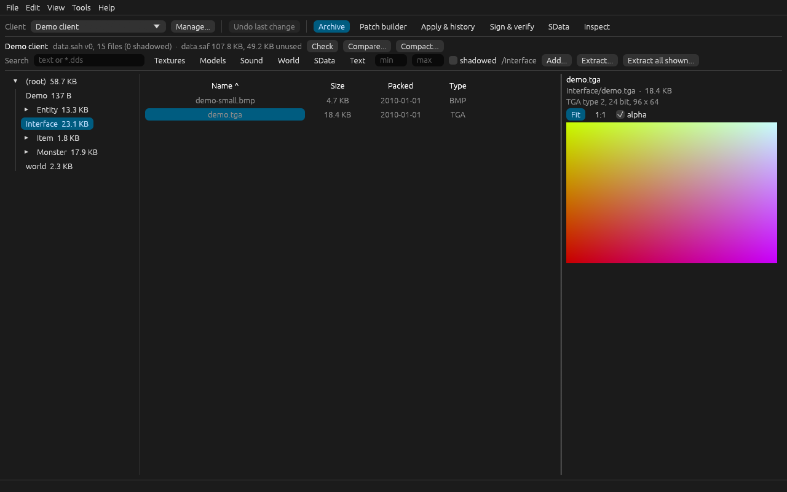
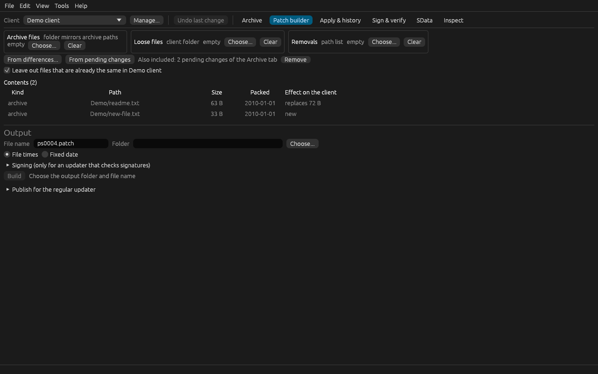
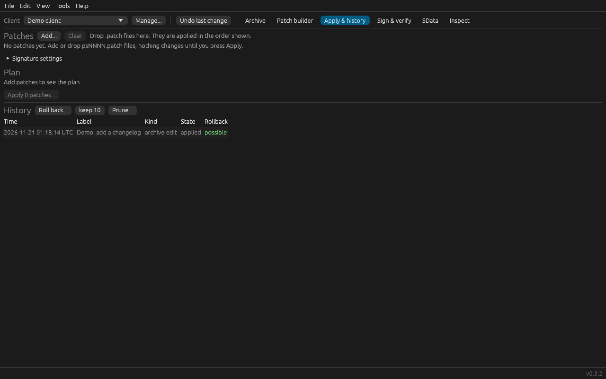

# Mod game files

For people who change client files: find a file, extract it, edit it, put it back with a backup, and undo it when it goes wrong. You need a client folder of your own (work on a copy while learning; see [getting started](../getting-started.md)). The toolkit never ships or downloads game files.

Save the client once, then use `@name` everywhere:

```
shaiya clients add mymod C:\Games\Shaiya-mod
```

Close the game before any step that changes the client.

## Browse and find



```
shaiya archive stats "@mymod"
shaiya archive list "@mymod" "*.dds" --long
shaiya archive list "@mymod" "interface/**" --folders
shaiya archive check "@mymod"
```

Patterns are case-insensitive globs: `*.dds` matches in any folder, `interface/*` is the files directly in `interface`, `interface/**` everything below it, `Item/Item.SData` one exact path. In Shaiya Toolkit, the Archive tab has the same search, plus previews for DDS, TGA and BMP images, text and hex.

Two entries with the same name in one folder (any letter case): the client loads the **later** one, so the earlier one is *shadowed* and `list` hides it (`--include-shadowed` shows it). `check` reports each shadowed entry. If you add a file whose name differs from an existing one only by case, you create exactly that situation; use `replace` to change a file instead.

## Extract

```
shaiya archive extract "@mymod" "interface/**" -o C:\work\interface
shaiya archive extract "@mymod" "Item/Item.SData" -o C:\work\original
shaiya archive cat "@mymod" Item/Item.SData -o C:\work\Item.SData
```

Folders are recreated under `-o`. Existing files stop the command unless you add `--force` or `--skip-existing`. Files keep their pack time unless `--no-times`. Names Windows cannot hold are escaped and never written outside the folder you chose. Keep the extracted original: it is your reference for the edit.

SData files (tables such as `Item/Item.SData`) are usually encrypted; extract them, then follow [SData files](sdata-files.md) to decrypt and re-encrypt them around your editor.

## Edit

Edit the extracted copy with the tool for that file type (a texture editor, a text editor with code page 949 for Korean text files, and so on). The toolkit does not edit game files itself. Keep the same relative path: `C:\work\mod\Item\Item.SData` is the replacement for the archive file `Item/Item.SData`.

## Put it back, with a backup

For a few files, change the client's archive directly. A folder is added with its contents' paths relative to the folder:

```
shaiya archive replace "@mymod" C:\work\mod --in-place --dry-run
shaiya archive replace "@mymod" C:\work\mod --in-place
shaiya archive add "@mymod" C:\work\newfiles --at mods --in-place
```

- `replace` changes files that are already in the archive and refuses paths that are not (`--add-missing` adds them). `add` refuses paths that already exist (`--replace` replaces them). Both print every refusal at once.
- `--at PREFIX` puts the files under an archive folder; `--as PATH` gives a single file its exact archive path.
- The dry run shows `+` for new files and `~` for replaced ones and writes nothing.
- The real run **appends** the new data to `data.saf`, replaces the index last, and prints a `backup:` line with the journal folder and the undo command. The old file contents stay in `data.saf` as unused space until you compact.
- Instead of changing the client, `-o C:\work\newpair` writes a separate, compacted archive pair and leaves the client alone.

Remove files: `shaiya archive remove "@mymod" test/junk.eft --in-place` (or `--list FILE`; `--ignore-missing` skips paths that are not there).

Loose files, the ones that live next to `game.exe` rather than inside the archive, are not part of `data.saf`. To change them, put them in a patch (`--loose`) and apply it; the toolkit saves the original in the journal first. See [make a patch](make-a-patch.md).

## Checks before files go in

Before an edit or a build, the toolkit looks at each file and prints what it finds as a warning; nothing is blocked. Shaiya Toolkit lists the same findings in the Add dialog and the Patch builder (and asks once for a file that is SEED-encrypted twice or whose checksum fails: **Add anyway** in the Add dialog, **Build anyway** in the Patch builder, **Publish anyway** in Publish). The full table is in [Checks before files go in](../tools/shaiya.md#checks-before-files-go-in).

- `sdata-double-encrypted`: the SData file was encrypted twice (its decrypted body is SEED-encrypted again). Decrypting it once with `shaiya sdata decrypt` gives the singly encrypted file.
- `sdata-crc-bad`: the SEED checksum fails or the wrapper is damaged.
- `sdata-state-differs`: you are putting a plain SData where the client's copy is encrypted, or the reverse. Some clients store theirs plain, so this is advice only; `sdata encrypt --like "@name"` takes the form from the client (see [SData files](sdata-files.md)).
- `texture-unreadable`: a `.dds` or `.tga` the toolkit's reader cannot open. The game may still read it; open it in an image editor to be sure.
- `empty-file`: the file has no bytes.

## Or make a patch instead



When other people need the same change, or you want one file that bundles several edits, build a patch from your folder and apply it. To try a patch on several test clients, use **Apply & history > Apply to several test clients...**: it asks about each client in turn and keeps one journal per patch for each client. A patch is also the easiest way to hand a modification to a friend:

```
shaiya patch build -o ps0001.patch --files C:\work\mod
shaiya patch apply "@mymod" ps0001.patch
```

## Undo



```
shaiya patch history "@mymod"
shaiya patch rollback "@mymod"
```

rolls back the newest journaled change: the old index returns, `data.saf` is cut back, loose files come back. You can undo several changes, newest first. What can stop it, and what `--no-journal` and `compact` do to your safety net, is in [undo and recovery](undo-and-recovery.md). In Shaiya Toolkit: Apply & history > Roll back....

Two habits that save trouble: keep a plain copy of the original client folder for anything you cannot download again, and run `shaiya archive check "@mymod"` after a series of changes.

## Reclaim space

Each change grows `data.saf`. `shaiya archive stats "@mymod"` shows the unused bytes. `shaiya archive compact "@mymod" --in-place --dry-run` says how much it would save and how much free disk space it needs; the real command rewrites `data.saf` and **ends rollback for every earlier change**. Prefer `compact -o NEWDIR` when you want to keep the option to undo.

## Start a new archive from a folder

`shaiya archive pack C:\work\files -o C:\work\newpair` builds a fresh `data.sah`/`data.saf` pair from a folder (names are stored in code page 949; `Thumbs.db` and similar are skipped). `shaiya archive swap "@mymod" C:\work\newpair` then puts it in place of the client's own and keeps the old pair, with a command to swap back.
