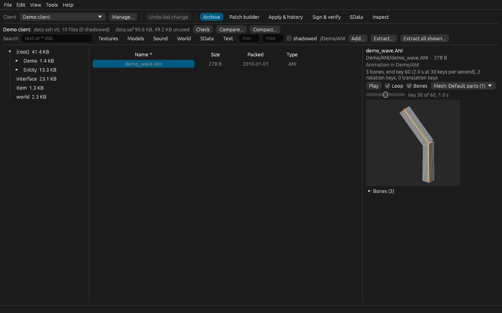

# Replacing an animation

For people who have made an animation of their own (in another tool), or want to change the keys of an existing one (no other tool is needed for that), and want to put it in place of an existing `.ANI` file of a client. The toolkit does not make animations; it can turn an `.ANI` into JSON and back so you can edit its key values, and checks the result against the file it replaces. It finds the file to replace, checks your file against it, puts it in with the usual backup and journal, and lets you look at the result. You need a client folder of your own and a saved name for it (`shaiya clients add`, see [mod files](mod-files.md)); work on a copy while learning, and close the game before any step that changes the client.

Everything the toolkit says about animations is **validated offline**: the checks, the preview and the playback were run on test data and on the files of one client, never judged in the game, apart from the single sentence in [what was seen in the game](#what-was-seen-in-the-game). The format is in [formats/ani.md](../formats/ani.md).

## 1. What can be replaced

An existing `.ANI` file, at the same archive path: the new file takes the old one's place in the archive. The toolkit does not create new animation slots; `shaiya anim import` writes an `.ANI` only to the file you name, never into the client.

## 2. Find the target

Pick the file by name. Character animations are named `<rig>_<number>_<name>.ANI` in `Character/<race>/ANI`; the rig is the first part of the name (`huwm` is the human male Fighter), and **each rig is its own target**: the skeletons of different rigs differ, and on US EP4.5 almost every file of a rig has reference matrices of its own.

```
shaiya anim info --from "@mymod" "Character/Human/ANI/huwm_*"
```

`info` prints one line per file: the kind and rig of an archive path ("Character rig huwm (Human)"), the bone count, the end key and seconds, the number of keys and the validation findings. In Shaiya Toolkit's Archive tab, select the `.ANI` to see the same facts and play it on a mesh the toolkit finds by name (section 7). A file that does not read to its last byte is shown with the reader's error and its bytes as hex, never half-read.

## 3. The skeleton rule

An `.ANI` file holds, for each bone of a skeleton, a reference matrix and the keys that move it. It has no bone names: a mesh is matched to its bones by **index**. So a replacement has to keep the **skeleton** of the file it replaces:

- the same **bone count**,
- the same **order and parents** of the bones,
- the same **reference matrices**, bit for bit (64 bytes per bone). On US EP4.5 almost every file of a rig has its own, so copy them from the exact file you replace, not from another file of the same rig.

Keys (the motion) may change, within the checks of section 4b (keys increase within each track, the end key is not below the last key, values are finite). Separately, the toolkit also asks for the same first field as the file it replaces (inferred to be the start key; not checked in the game). It is not part of the skeleton rule, and the toolkit reports it on its own line.

## 4. Edit keys as JSON

If your motion needs only different keys, you can edit them as text instead of making a new file in another tool. The toolkit writes the `.ANI` as a JSON text, you change the numbers, and it writes the `.ANI` again. Nothing here writes into a client: `import` writes the file you name with `-o`, and you put it in as in section 6. An unedited JSON gives back the exact bytes of the file it came from (US EP4.5: all 3,509 `.ANI` files; the eight other test clients have their index only). The format of the JSON is in [formats/ani.md](../formats/ani.md#json-export-and-import).

**a. Export the exact file you replace.**

```
shaiya anim export "Character/Human/ANI/huwm_117_emoti002.ANI" --from "@mymod" -o huwm_117_emoti002.json
```

`-o` must end in `.json`, and an existing file is replaced only with `--force`. The JSON names the file by its archive path (or, for a file on disk, by its file name only), never by a folder of your computer. Export refuses a file that does not read to its last byte, and an `.ANI` with a NaN or infinite key value (exit 3).

**b. What to edit.** Each bone has `rotation_keys` (one `[key, x, y, z, w]` per line, `x y z w` a unit quaternion) and `translation_keys` (`[key, x, y, z]`), and the file has an `end_key`. Keys are in units of 1/30 second and must strictly increase within each track; `end_key` must not be below the last key; every value must be finite (a number too large for a 32-bit float is refused). A key order or end key mistake is a validation error, so the file does not pass and is not written (exit 1). A rotation that is not a unit quaternion only gets a warning (`quat-not-unit`, more than 0.001 from length 1).

**c. What not to edit.** The number and order of the bones, `parent`, `matrix_hex` and `first_field` (inferred to be the start key; not checked in the game) must stay as exported: they are the skeleton and the first field of section 3, and import refuses a change (exit 1, see d). Each bone's `index` must equal its position, and an unknown key or other `columns` are refused (exit 3, like a refused value).

**d. Import it, checked against the file it replaces.**

```
shaiya anim import huwm_117_emoti002.json --like "Character/Human/ANI/huwm_117_emoti002.ANI" --from "@mymod" -o my_emote.ANI
```

`--like` is required for an `.ANI`: it names the file you are replacing (with `--from`, a path in the archive). The import runs the same check as `anim compare` (section 5) and prints the same lines. Exit 0 means the file passed and was written; exit 1 means the validation errors or differences are printed (with `--json`, the keys of `compare` and `written: false`), `nothing written` follows and no file is made. A refused value, index, unknown key or `columns` exits 3, a missing `--like` exits 2, and an `-o` inside a client folder or one that already exists exits 4 (see [shaiya anim](../tools/shaiya.md#shaiya-anim)). The `-o` file must end in `.ANI`.

**e. Then** check it with `anim compare` and `anim validate` (section 5) and put it in (section 6). The file is validated offline like every file in this guide.

## 5. Check your file

```
shaiya anim compare my.ANI "Character/Human/ANI/huwm_117_x.ANI" --from "@mymod"
```

Exit 0 means the file passes: same skeleton, same first field and no validation error. It prints `same skeleton as ...` or each difference (bone count, parents, matrices), the first field on its own line, your file's validation errors, and `passes` or `does not pass` (exit 1). Exit 3 means a file did not read or the target is not in the archive. `shaiya anim validate my.ANI` checks the file alone (exit 1 when it has an error). With `--json` the result is machine readable ([shaiya anim](../tools/shaiya.md#shaiya-anim)).

Passing is a result of the toolkit's own checks. It does not say that the game accepts the file.

## 6. Put it in

**In Shaiya Toolkit.** In the Archive tab, right-click the file, choose **Replace with file...** and pick yours. The toolkit compares it with the copy already in the client first; if the skeleton differs it asks (**Add anyway** or **Cancel**) before queueing anything, and lists the finding (`anim-rig-differs`). A different first field, a file that does not read, and validation errors only warn. Nothing is written until you press **Apply to client...** in the Archive tab's pending panel; it asks first and writes a journal.

**On the command line.**

```
shaiya archive replace "@mymod" my.ANI --as "Character/Human/ANI/huwm_117_x.ANI" --in-place
```

The same checks run, print a warning for each finding and never change the exit code. `--in-place` writes a journal; without it you must name `-o` for a new pair of files. See [mod files](mod-files.md).

A patch build (`shaiya patch build`, the Patch builder) has no copy of the client to compare with, so it checks that the file reads and has no validation error, but cannot run the skeleton check. Run `anim compare` yourself before building.

## 7. Look at it

Select the file in the Archive tab, in a client that holds your replacement. The player shows the animation posed on a mesh, with **Play/Pause**, a slider over the keys, **Loop**, **Bones** (the skeleton drawn as lines) and a **Mesh** choice: the default parts, a single mesh, or the skeleton alone. Time runs at 30 key units per second. The meshes (`.3DC` files) are found by name in the sibling `3DC` folder and are offered only when every bone they use exists in the animation; without one the skeleton is drawn. The picture is an approximation of the game's playback, validated offline.



## 8. Undo

Every change you apply is journaled, except with `--no-journal` or Compact, which make none. In Shaiya Toolkit use **Undo last change** or **Apply & history > Roll back...**; on the command line:

```
shaiya patch rollback "@mymod"
```

puts `data.sah` and `data.saf` back byte for byte. See [undo and recovery](undo-and-recovery.md) for what can block a rollback.

## 9. Share it

Queue the replacement in the Archive tab and press **Make patch...**, or use `shaiya patch build`, then sign and publish as in [make a patch](make-a-patch.md). Players apply the patch the usual way and can roll it back.

## Retime, trim or copy tracks

Three tools make a new `.ANI` from one that exists, without editing JSON. Each result must pass the same check as `compare` against the file it was made from (same skeleton, same first field, no validation error), or nothing is written.

- **Retime** makes the animation longer or shorter: `shaiya anim edit retime huwm_117_x.ANI --from "@us" --factor 0.5 -o fast.ANI` (a factor from 0.1 to 10), or `--seconds 2` for a length. Every bone that has a track is sampled again at each whole key of the new length, so no two keys collide, and the first and the last pose of the original stay the first and the last pose of the result (detail between two whole keys of the new length is lost, for example the peaks of a very fast motion at half length). Most keys that a straight line (for rotations, a slerp) reproduces within 1e-5 are dropped; a long straight run keeps one key in 64.
- **Trim** keeps a part: `shaiya anim edit trim huwm_117_x.ANI --from "@us" --start 10 --end 40 -o short.ANI` keeps keys 10 to 40 and moves them to the file's first field. A part outside the animation is refused.
- **Copy tracks** takes the rotation and/or translation tracks of some bones from another animation: `shaiya anim edit copy-track a.ANI --source b.ANI --bones 3,4,5 --rotation -o mixed.ANI`. Both files need the same skeleton and first field, or it is refused with the differences.

The outputs follow the rules of `import`: a new file (`--force` replaces one), never inside a client folder. In Shaiya Toolkit, right-click an `.ANI` and choose **Edit animation...**: the window shows the result as you change the settings, **Save as new file...** writes it, and **Queue as replacement** adds it to the queued changes like Replace with file. All of this is validated offline against the toolkit's own pose rules; how the game plays an edited file has not been tested.

## Compare two animations

To see how your animation differs from the one it replaces, or how two animations of a rig differ, compare their poses:

```
shaiya anim diff my.ANI "Character/Human/ANI/huwm_117_x.ANI" --from-b "@mymod"
```

`A` is the first file and `B` the second (each a file on disk, or with `--from` / `--from-b` a path in an archive). The command prints `identical: ...` and exits 0, or lists what differs and exits 1: the skeleton (bone count, parents, reference matrices) and the first field the way `compare` does, the end keys, and the bones whose pose differs, largest turn first, with the largest turn in degrees and the largest move in units over all keys, and how many keys each file has for the bone. It compares the toolkit's own computation of the poses (the same one the player uses); it says nothing about what the game does with either file. A difference in the skeleton means the game would not take the file as a replacement in the same way `compare` says.

In Shaiya Toolkit, right-click an `.ANI` in the Archive tab and choose **Compare with...**: pick another `.ANI` of the same folder, or "the same file in" another saved client (that client's archive is opened read-only), and press **Compare**. To export a whole folder of animations as JSON at once (to diff or edit them as text), right-click the folder and choose **Export folder as JSON...**, or use `shaiya anim export "Character/Human/ANI/" --from "@us" --out-dir json-out`. In a `Character/<race>/ANI` folder the **Rig** box shows the animations of one rig only, and a `.3DC` mesh's **Animation** box plays any animation of its rig on it.

## What was seen in the game

Seen in the game (US EP4.5): basic playback of one replaced victory emote on the `huwm` rig (the human male Fighter); everything else is validated offline only.

## Other episodes

The toolkit treats every client the same: it lists, extracts and replaces animation files on any client. It previews and checks a file when, and only when, the file reads to the last byte. The contents of the animation files were read only on US EP4.5 (patch 108): all 3,509 `.ANI` files read to the last byte. The eight other test clients have their index only (files counted, none read), so whether their files read is not checked; if one does not, the toolkit says so and shows the bytes.
