# Shaiya SVMap Editor user guide

Shaiya SVMap Editor is a desktop program for server map files (`<id>.svmap`, for example `PS_Game\Data\Map\35.svmap`). It shows each map over the client's real terrain. You edit everything in the file: monster areas, NPCs, portals, bind areas, regions and blocked cells. The editor checks the result against the client. It can also edit the client's copy of the map, the server's `Map.ini`, and make a whole new map. This guide is also the editor's Help window (**Help > User guide**, or F1): the same text, with the menu paths below turned into links that run the command.

> **What it writes.** Saves of `.svmap` files, `Map.ini`, `MapWar.ini` and staged client files go through a `.tmp` file that is read back before it replaces the old file. Export patch and Export folder read back what they wrote, and Install checks the result by reading the staged files back from `data.saf`. Backup copies and the log are plain writes. In the server map folder it writes `<id>.svmap` and, the first time you save a file, `<id>.svmap.bak` beside it. In the server data folder it writes `Map.ini` or `MapWar.ini` when you save them in the Map.ini editor or with Add a map, with the same `.bak`. In the staging folder you pick it writes edited client files: `data/world/<id>.wld`, `data/world/<id>.txt`, `data/interface/MiniMap/<id>.tga` and `data/world/Field/<id>/*.dds`. A note file `svmap-editor-new-map-<id>.txt` goes there too, outside `data`. Export patch and Export folder write `psNNNN.patch` or a copy of the staged files into a folder you pick, and never replace a file. The CSV, JSON and PNG exports of File > Export write the file you pick and can replace it, but never a `.svmap`, `.sah` or `.saf` file. In a test client folder you pick, Install changes `data.sah` and `data.saf` and writes `data.sah.svmap-editor`, `data.sah.svmap-editor-<UTC time>`, `svmap-editor-install.json` and `data.sah.bak`. It also writes a temporary `.update.saf.<number>.shaiya-tmp` file. Uninstall puts the index back, cuts `data.saf` back to its old length when nothing else changed it, and removes the record. Export patch and Install also work in a temporary folder under the system temp folder; see Sharing your client changes. Copy loose adds new files under `data/` there. Install keeps no journal. The editor's own data folder holds `settings.json`, `log.txt`, `recovery` and `backups`. **What it never does.** It never writes the client folder it reads from. It never writes any SData file, `sysmsg-uni.txt`, `.dg` or `.smod` file, a texture inside the client, `game.exe` or a DLL. It uses no database, downloads nothing and sends nothing. Telling your server about a change (restart, or your server's map import) is a step you do yourself; see Checking and saving.

## Install and start

There is no installer and nothing to install first. The editor is part of the Shaiya Toolkit download. The all-in-one zip holds it as `shaiya-svmap-editor` (`shaiya-svmap-editor.exe` on Windows) beside `shaiya-toolkit` and `shaiya`. Unzip it anywhere and run it. The zips and how to check them are on the Install page of the toolkit documentation.

It runs on Windows, Linux and macOS. The author tested it on Windows. The macOS and Linux builds are untested until a tester confirms them. The programs are not code signed. On Windows, SmartScreen may warn the first time: choose More info, then Run anyway. On macOS the app is not notarised: right-click it and choose Open. On Linux you need a desktop with X11 or Wayland. The editor needs a graphics driver for Vulkan, DirectX 12, Metal (macOS) or OpenGL. It picks the API itself.

The first start opens the setup, which asks for your folders (see the next page). After that the editor opens where you left it: the same folders, the same maps in tabs, the same cameras. Its settings, log, recovery files and backups live in one data folder: see Files the editor uses.

You can also start it from a command prompt with a file, a folder or a client: `shaiya-svmap-editor 35.svmap`, `shaiya-svmap-editor --folder D:\server\PS_Game\Data\Map --client D:\Shaiya --map 1`. See Command line. Dropping a `.svmap` file, a map folder, a client folder or `data.sah` on the window works too.

## Verified on and other episodes

The editor was written and checked on one client and two sets of server files: the US EP4.5 client (patch 108), the original EP4.5 server files, and the Afterglow server. Everything else is detected and handled by refusing, warning or a setting. Nothing is assumed silently. The table says what was checked and what the editor does on anything else. The version matrix of the toolkit documentation has the numbers per client.

| What | Checked on | On anything else |
|---|---|---|
| `.svmap` layout | the 77 original server map files, and Afterglow's maps | The reader must end at the last byte. A file that does not parse is refused: an error in the editor, exit code 3 in `shaiya svmap`. Maps of EP3 and EP5.4 servers are reported to share the layout. That is unverified. |
| Client `world/<id>.wld` | US EP4.5: all 83 files write back byte for byte | Each file is checked on its own. A file that does not write back stays read-only on the client side. `shaiya svmap wld-check` names it. |
| `world/<id>.txt` (area names) | US EP4.5 | The editor keeps every line it does not understand. |
| Name code page | cp949, the EP4 client | A setting in **Edit > Preferences...**: cp949, Shift-JIS, GBK or Windows-1252. |
| `Monster.SData` and `NpcQuest.SData`, with the gatekeeper gates | US EP4.5. Both also read on ru-ep3, ru-ep45, fr-ep54 and phoenix-ep63, and NpcQuest on cn-ep4. | When a table does not read, the rules that need it turn off with one note. In the version matrix `Monster.SData` fails on kr-ep8, fawkes-v68 and cn-ep4, and `NpcQuest.SData` on kr-ep8 and fawkes-v68. |
| Map names (a table of the EP4.5 client, mirrored in the editor) | US EP4.5 patch 108 | Used for display and for the info rule `map-no-name`. Never used to decide a write. On another client the names and that rule may be wrong, and a note says so. Without a client the map number is shown. |
| Map id limits | the original server (`MapCount`), Afterglow (0 to 255 except 200) | The Target server setting. Other server builds are unverified. |
| Map 70 is forced to size 1600, and ids 100 to 200 limit some item uses | US EP4.5 | The wizard warnings say "on the EP4.5 client". |
| Field chunk textures made by Add a map | US EP4.5 (map 110 loads) | The wizard note says the files follow the EP4.5 layout and other episodes are unverified. |
| Loose files lose to the archive | US EP4.5 | Copy loose refuses every path the archive holds, which is safe for either order. |
| `data.sah` with a header | all nine clients of the version matrix | A `data.sah` without a header is refused by Install. Use an extracted folder to read such a client. |
| Minimap `interface/MiniMap/<id>.tga`, 512 x 512 | US EP4.5 | Written only when you tick it. |

### Client notes

When a client opens, the editor tells you what does not read as it does on EP4.5. The client chip in the toolbar turns to the warning colour and its tooltip lists the notes. `shaiya svmap check`, `spawns` and `bulk` print the same notes with `--client`. A note is one of three sentences:

- `Monster.SData` did not read with the EP4.5 layout: monster names and levels and the monster rules are off.
- `NpcQuest.SData` did not read with the EP4.5 layout: NPC names and the NPC and gatekeeper rules are off.
- The map names and the `map-no-name` rule come from the EP4.5 client's table, and this client's `sysmsg-uni.txt` lacks some of its ids. Some names and `map-no-name` findings may be wrong.

A note changes nothing in your files. It tells you which names and rules to doubt.

### What was checked in the game

These results are from a US EP4.5 test client. Anything not listed here has not been checked in the game.

- Portal box edits load in the game. Building, placement and NPC edits work in the game.
- Terrain height edits work: players walk on a raised hill. Lowering the ground below -0.4 gives shallow water without swimming.
- Install and Uninstall into a copy of a test client work.
- A new map with id 110, made by Add a map, loads on the client and imports on the Afterglow server.

Not checked in the game:

- A blank field of 2048 units (2 x 2 chunks).
- The area banner picture (`<id>_NN.tga`) and the order of the lines in `<id>.txt`.
- The orientation of a made minimap.
- A `<id>.txt` that holds only a byte order mark.
- Any client other than US EP4.5.
- Any server other than the original EP4.5 files and Afterglow.

Test every edited map on a copy of your client first.

## Getting started

The editor needs two folders, and only the first is required.

**The server map folder** holds the server's map files, one per map, named by map number: `0.svmap`, `1.svmap`, … `108.svmap`. In the server files it is `PS_Game\Data\Map`. Pick the folder itself. The editor edits these files. Before the first save of a file it keeps the original as `<number>.svmap.bak` beside it. It also keeps a copy of every save in its own data folder. Working on a copy of the server folder is still a good idea. Set the untouched copy as the **reference folder** to compare against. The setup asks for it and it is optional. The Changes tab uses it (see Compare and revert).

**The client folder** (optional) gives the editor the terrain, the minimap, the dungeon floors, the monster and NPC names and the client's copy of each map. The editor checks that the server file and the client agree on portals, NPCs, region names and map size. You can pick either of two kinds of folder:

- **Your game folder**, the one with `data.sah` and `data.saf` in it (next to `game.exe`). This is the usual choice. The editor reads the game archive where it is. It extracts nothing to disk and never writes to it. The game can stay open while you edit. Pick the folder. Dropping `data.sah` on the window also works.
- **An extracted folder**: the game data unpacked by an extractor, with `world`, `Monster`, `Npc` and `interface` folders and `sysmsg-uni.txt` at its top. Pick the folder that *contains* `world`. Use this when the files you want to check are not packed into `data.saf` yet.

Use the same client data your players have: the checks compare the server files with that client's maps. Without a client folder the editor still opens and saves every map, but shows a plain grid with numbers instead of names and skips the client checks.

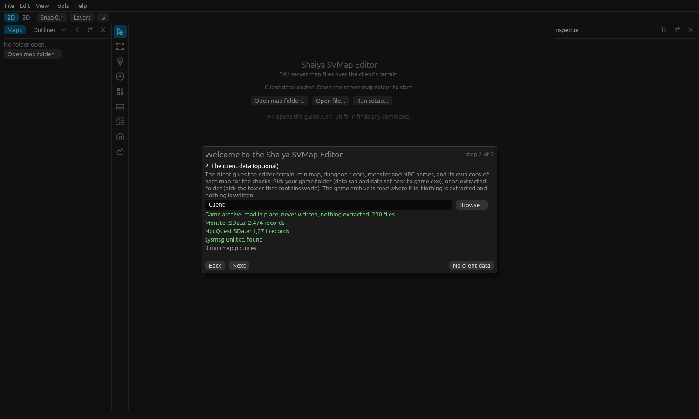

You can run the setup again with **Help > Setup...**, or change the folders in **Edit > Preferences...**.

### The window at a glance

- **Browser** (left): two tabs. **Maps** lists every map of the folder with its number and name, a D tag for dungeons and a dot for unsaved changes. Double-click opens a map in a tab. The box above filters by number or name. **Outliner** lists the records of the open map by section, with an eye (show or hide), a lock (cannot be selected) and a plus (add a record) per section.
- **Viewport** (middle): the map from above (2D) or in 3D. Tabs above it switch between open maps. A dot after the name means unsaved changes. The **tool palette** at its left edge has one icon per tool: hover for the name, the key and one line.
- **Inspector** (right): the fields of the selected record. Each field has a question mark that says what the server does with it. With nothing selected it shows the map's counts. Rarely used fields sit in the **Height** and **More** sections, which start closed.
- **Dock** (bottom, hidden at first): **Problems**, **Changes**, **Find** and **Spawns**. It opens when you search, click the problems chip or pick **View > Layout > Review** or **Tools > Spawns > Spawn check**.
- **Toolbar** (top): one row with 2D and 3D, **Snap**, **Layers**, the level chip, the options of the active tool, and at the right the problems chip and the client chip.
- **Status bar** (bottom): the cursor position, the cell, the region and a hint for the active tool.

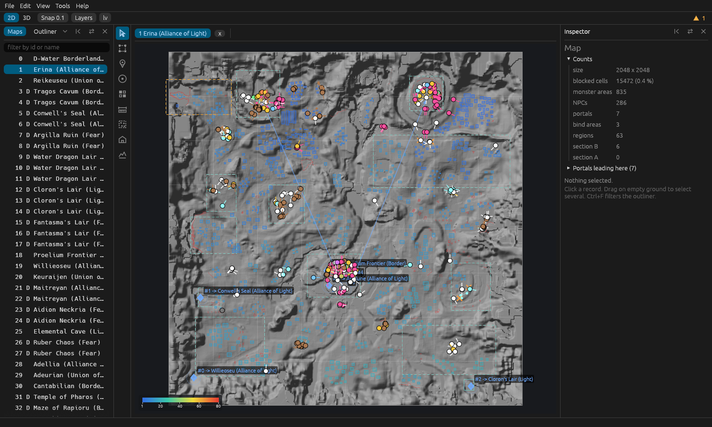

## Moving around

### The 2D view

- The mouse wheel zooms at the cursor. Dragging with the middle or the right button pans; a right click that does not move opens the context menu (see Selecting and editing).
- World x runs to the right and z up: north is up, like the client's map.
- **View > Frame selection** (F) zooms to the selected records. **View > Frame map** (Home) fits the whole map.
- **View > Go to...** (Ctrl+G) jumps to a position or a record, see below. **File > Quick open map...** (Ctrl+P) opens a map by number or name.
- **View > Copy cursor position** (Ctrl+Shift+C) copies x and z; **View > Copy as GM move command** copies `/bmove x z map`, ready to paste into the game's chat. Clicking the position in the status bar copies it too.

### The overview

When you are zoomed in, a small map of the whole map appears at the bottom-right of the 2D view (the **overview inset**). It shows the terrain, minimap or dungeon floor, a white rectangle for what you see now and yellow dots for the selection. Click or drag inside it to move the view there. It is hidden while the whole map is in view. The Layers popover can switch it off.

### Bookmarks

**View > Add bookmark...** (Ctrl+B) keeps the current view of this map under a name. The default name is the region at the centre of the view, or its x and z. The Bookmarks submenu of the View menu lists the bookmarks of the open map: click one to go there, **rename** or **x** to delete. `@name` in Go to takes a bookmark too. Bookmarks are kept per folder and map in the settings.

### Find in all maps

**Edit > Find in all maps...** (Ctrl+Shift+F) opens the **Find** tab of the Dock and puts the cursor in its box. It searches every map of the open folder. The maps you have open count with their unsaved edits. Pick **this map** to search only the open map. Words in the query must all match the same record:

| you type | it finds |
|---|---|
| `thief` | records whose text has the word: monster names, NPC type and name, destination map name, region name, and any record of a map whose name has it |
| `mob:2008` | monster areas with monster 2008 |
| `npc:1/159` or `npctype:1` | NPCs of type 1 with type id 159, or all of type 1 |
| `portal:18` | portals that lead to map 18 |
| `region:artlum` | regions whose name has the text |
| `code:portal-far` | records with a finding of that rule (maps you have not opened need Problems set to all maps once) |
| `lv:10-20` | monster areas whose mean level is 10 to 20 |
| `map:1-5,35` | records of those maps (ids, ranges and lists) |
| `count:2-3` | monster areas whose monsters add up to 2 to 3 |
| `42` | a plain number: areas with monster 42, NPCs with type id 42, portals to map 42, shown in groups |

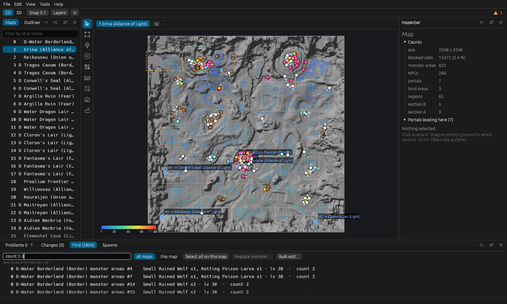

Click a result to select its row, and the record when it is on the open map. Double-click opens the map and selects and frames the record. **Select all on this map** selects every result that is on the open map. With **this map** and **inside view** it selects only what you can see. That is also what **Edit > Select matching...** does. **Edit > Select similar** selects the records with the same key as the selection. The key is the monsters of an area, the type and id of an NPC, the destination of a portal or the country of a bind area. **Edit > Select all** (Ctrl+A) selects the sections of the selection, or every visible and unlocked section.

With `mob:<id>` in the query, **Replace monster...** puts another monster in those areas on every map: see workflow 7. The same words with an action after `=>` are a bulk edit: see Bulk edit spawns. Hovering a result outlines the record in the view.

### The 3D view

**View > Switch 2D / 3D** (Tab) shows the terrain, dungeons and records as boxes, pins and cylinders. It also shows the buildings, shapes and trees of the map as the client's own models.

- Left drag on empty ground turns the view around the ground point under the cursor, and that point stays under the cursor. Preferences can turn this off (**3D: orbit around the point under the cursor**); the view then turns around its focus.
- Left drag on a record moves it along the ground (Ctrl: height only, Esc cancels). Right or middle drag pans, the wheel zooms.
- F focuses the selection, Home shows the whole map, N turns to face north. These moves, Go to and the compass take 0.2 seconds. Preferences can turn this off (**3D: smooth camera moves**).
- The compass at the top right shows where north is. Click it to face north.
- Shift+F starts the fly mode: WASD move, Q and E go down and up, the wheel changes the speed, Shift is fast, dragging looks around.
- Clicking selects like in 2D (Shift adds, Alt+click cycles); the selection is shared between 2D and 3D. The record under the cursor, and the record of a hovered row in the Outliner or Problems, gets a white outline.
- The Box tool works on the ground: drag to draw the box with the draw target and the template of the toolbar. With the draw target section B a click adds a point. With a template a click stamps it. The Measure tool works too. Paint and Scatter are greyed with the reason "2D only".
- A right click opens the same menu as in 2D.
- A selected monster area, bind area or region shows its size above it as width x depth x height.
- The heatmap (H) lies over the terrain. Dungeon meshes do not show it. The sky takes the map's fog colour, a little darker.

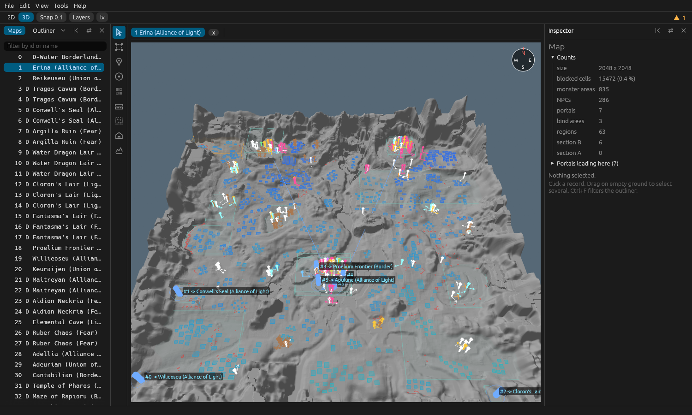

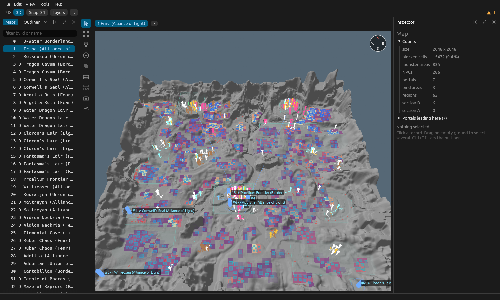

Without a client folder the 3D view shows a flat plane and the records. Water and animated objects are not drawn.

### Layouts

The window has three panels: the Browser, the Inspector and the Dock. Each can be shown, hidden, collapsed to a thin rail and moved to the other side. The three small buttons at the right of a panel's header do that: collapse, move and hide. A right click on the header gives the same actions and **Reset size**. A collapsed panel leaves a rail with its tab icons. Click an icon to open the panel on that tab.

Browser and Inspector on the same side share one panel. Drag the handle between them to change the split. The Browser menu (the arrow in its header) has **Show both**, which puts Maps above the Outliner, and **Show size column**.

A **layout** is one arrangement of the panels. The View menu has three built-in layouts:

| Layout | What it shows |
|---|---|
| Simple | Browser on the left (Maps tab), Inspector on the right, Dock hidden. This is the default. |
| Editing | The Outliner tab, and the Dock collapsed to a rail at the bottom. |
| Review | The Dock open on Problems. |

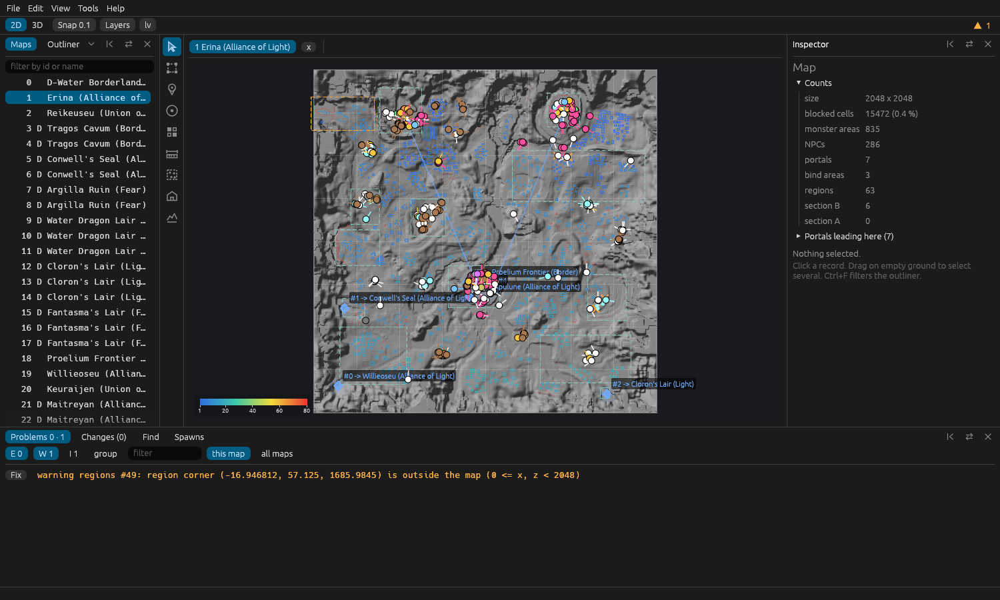

Pick a layout under **View > Layout > Simple**, **View > Layout > Editing** or **View > Layout > Review**. A panel you changed since marks the name with "(changed)". **View > Layout > Save layout...** keeps the panels as they are under a name of your own. **View > Layout > Manage layouts...** renames and deletes saved layouts. Deleting the layout in use switches to Simple. A built-in name cannot be reused.

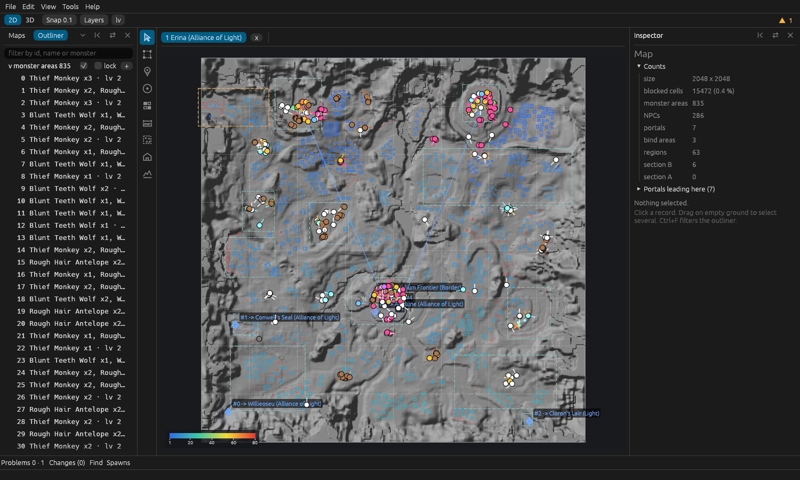

The Dock opens by itself when a command needs it: Find, the problems chip, Select matching, Compare with reference and Spawn check. It never closes by itself.

**View > Panels > Browser**, **View > Panels > Inspector** and **View > Panels > Dock** (Ctrl+1, Ctrl+2, Ctrl+3) show or hide a panel. **View > Panels > Viewport only** (F11) hides every panel, the toolbar, the tool palette and the status bar. F11 or Esc brings them back exactly as they were. Viewport only is not saved: the next start shows the saved layout.

The map colours stay the same in both themes. **Edit > Preferences...** has the theme.

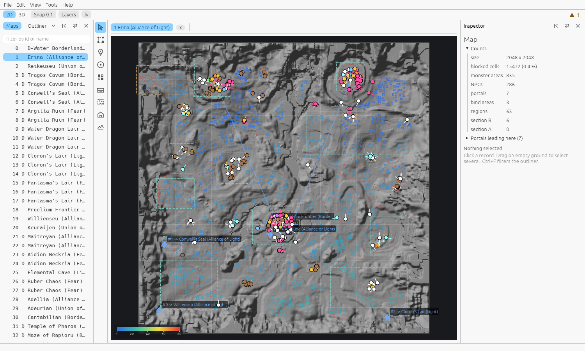

### World view

**View > World view** (Ctrl+Shift+M) opens a tab with every map of the folder as a card. It needs an open map folder. Close it with its x.

A card shows the client minimap, or a picture of the blocked cells when the map has none. Dots on it mark the monster areas, coloured by level. Three lines of text give the number and name, the size with the areas and monsters, and the level range with the portals going out and coming in. A dot marks unsaved changes. Chips show problems and spawn findings once those checks have run.

Arrows show the portals. A solid line with two heads is a two-way link. A dashed amber line is a one-way link. Lines get wider with the number of portals, up to 4 pixels. A ring on a card counts portals to the same map. A red stub is a map without a file in the folder. The grey stub is map 200, the guild ranking. Point at a line to read its portals.

Point at a card to light its links and dim the rest. Click selects it, and the Inspector shows its map. Double-click opens the map. Drag moves a card, and the position is kept for this folder. The wheel zooms and a middle or right drag pans. **Home** or **Frame all** fits every card.

The filter box dims cards that do not match a number or name. The check boxes hide fields, dungeons, maps from 100 and the monster dots.

**By id** puts fields first, then dungeons, in rows of 10. **By links** places maps with many portals between them close together. It gives the same result every time. Both ask before they replace positions you moved.

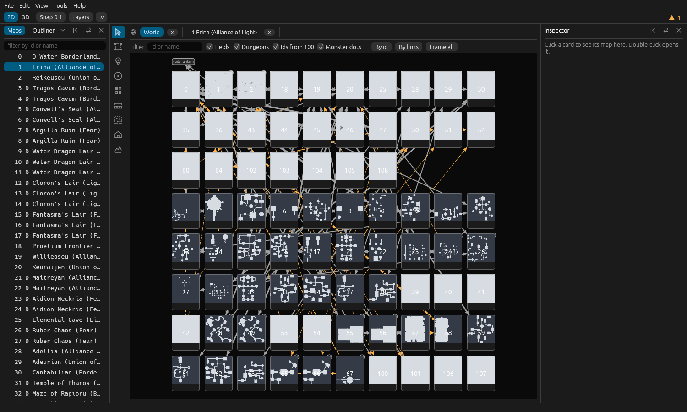

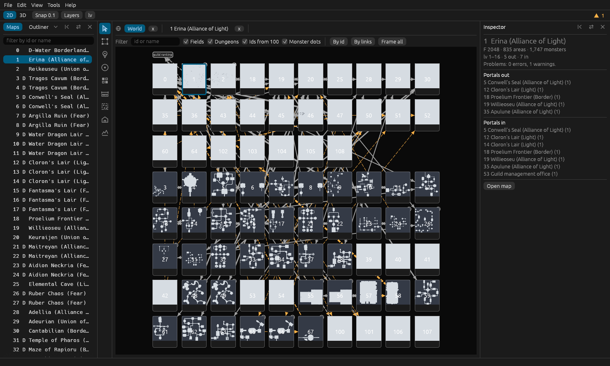

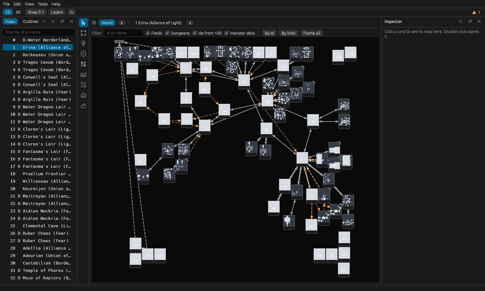

### Layers

The **Layers** popover on the toolbar (also the Layers submenu of the View menu) switches what is drawn. It has four groups:

- **Background**: terrain shading, the client minimap with an opacity slider, the dungeon floor, and the 2D dots for buildings and trees.
- **Records**: one row per section of the file (monster areas, NPCs, portals, bind areas, regions, section B and section A). The eye shows or hides the section. The lock makes it unselectable.
- **Overlays**: blocked cells (red), the 64-unit grid, the `.wld` ghosts (grey outlines of what the client's own file has), labels, the overview, the **heatmap**, **rulers** and **compare**. Compare shows what differs from the Changes tab's reference (see Compare and revert). It stays off until you pick a reference other than the last save.
- **3D**: buildings and shapes, trees, the **3D object distance** slider, **cull backfaces** and **3D stats**. Models farther from the camera than the distance are not drawn. 3D stats is a box with draw calls and triangle counts.

Monster areas are coloured by the mean level of their monsters, blue for level 1 to red for level 80. With the client data open, a legend of that colour bar sits at the bottom-left of the 2D view. The **lv** chip on the toolbar sets a **level filter**. Monster areas outside the range are dimmed to a faint outline and cannot be picked. An area whose level is not known is never dimmed. A record with an error has a red outline and one with a warning an orange one. Yellow is the selection and white is what is under the cursor.

**Heatmap**

The heatmap shows where the monsters are. It is off at first. Press **H** to cycle off, density and level, or pick **View > Heatmap > Density** or **View > Heatmap > Level**. The Layers popover also sets the tile side (16, 32 or 64 units), the opacity and the top of the scale.

- **Density** counts monsters per tile. Each monster area spreads its total count over the tiles it covers, so a tile holds the part of each area that overlaps it. The colours run from purple through red and orange to pale yellow. The legend at the bottom-left shows 0 and the top of the scale. By default the top is the 95th percentile of the tiles that are not empty.
- **Level** shows the mean level of the monsters in a tile, weighted by count, in the same blue-to-red colours as the monster areas. It needs the client data. A tile with almost no monsters stays empty.

The status bar shows the tile under the cursor, for example "3.2 per tile · lv 14". Hidden monster areas and areas outside the level filter are not counted. The picture follows your edits a moment after you stop.

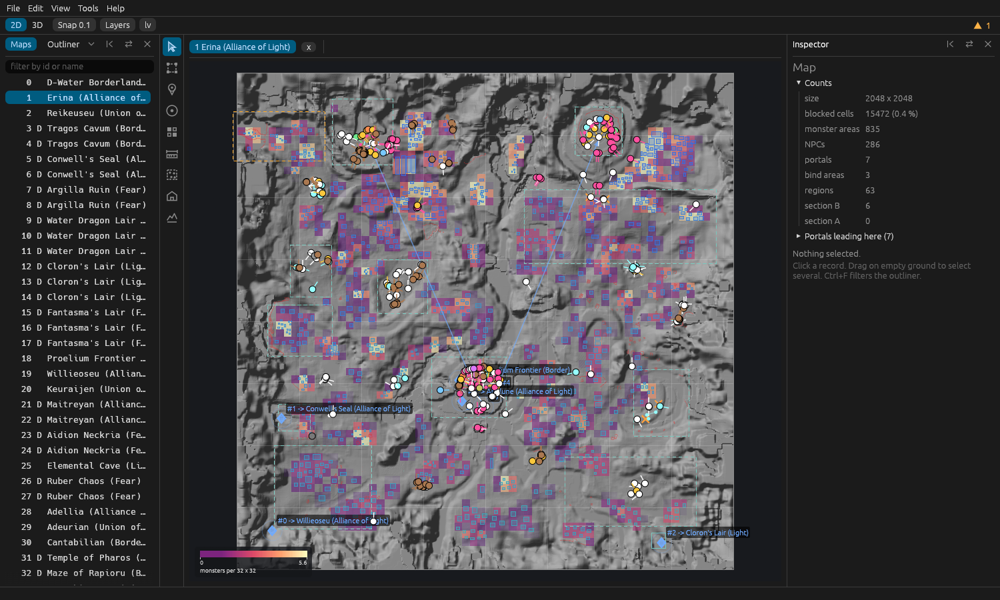

**View > Rulers** (Ctrl+R) draws a ruler along the top and the left of the 2D view, with the cursor marked on both. The ticks step by 1, 2 or 5 times a power of ten and are at least 60 px apart.

### Go to

**View > Go to...** (Ctrl+G) takes one line, with a live preview under it:

- `1662 1655` or `1662, 1655, 20`: a position (x z, or x y z).
- `cell 3391102`: a cell of the blocked grid (z * size + x), the centre of the cell.
- `area 12`, `npc 7`, `portal 3`, `bind 0`, `region 9`, `b 2`: select that record and frame it.
- `map 35`: open that map.
- `@gate`: a bookmark of this map.
- `/bmove 1662.2 1655.3 1`: the GM command, so a position copied from the game or from **View > Copy as GM move command** works too; with a map number it opens that map.

A position out of the map, or a record number that does not exist, is shown in red and Enter does nothing. Going to a position centres the view and marks the spot with a crosshair for three seconds.

### The command palette and quick open

**View > Command palette...** (Ctrl+Shift+P) lists every command with its keys; type a few letters of its name. Commands that cannot run now are greyed, with the reason. **File > Quick open map...** (Ctrl+P) finds a map by number, name or file; the open and recent maps come first. In either popup, `>` switches to commands and `:` to Go to. Esc closes it.

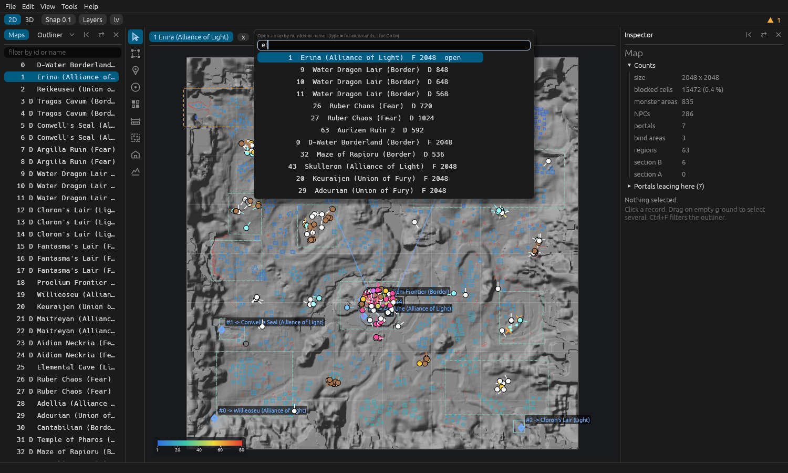

### Measuring distances

The Measure tool (key 6) reads distances in the 2D and the 3D view.

- Click points to build a path. A click within 8 px of a box corner, a box centre, an NPC point or a portal snaps to it. Ctrl turns snapping off. Shift snaps the step to a multiple of 15 degrees.
- Each segment shows its length. The end of the path shows the total, the differences in x, z and height, and the last bearing. 0 degrees is north and 90 degrees is east.
- Enter or a double-click ends the path. Backspace takes the last point back. A click on the first point of a path of 3 points or more closes it, and a closed path also shows its area in square units and in cells.
- In the 2D view a drag measures one line.
- **Radius** in the toolbar, or Alt+drag, draws a circle with its radius. A faint ring marks the portal range of 40 units while the radius is within 2 units of it.
- Ctrl+C copies the result as text, for example `length 123.4 (3 segments), area 812.0`.
- A measurement stays until Esc, a new measurement or another tool. In the 3D view it follows the ground, and the clicks land on the ground.

An NPC with two points or more shows its path in the Inspector, for example "Path 84.2 units (5 points)".

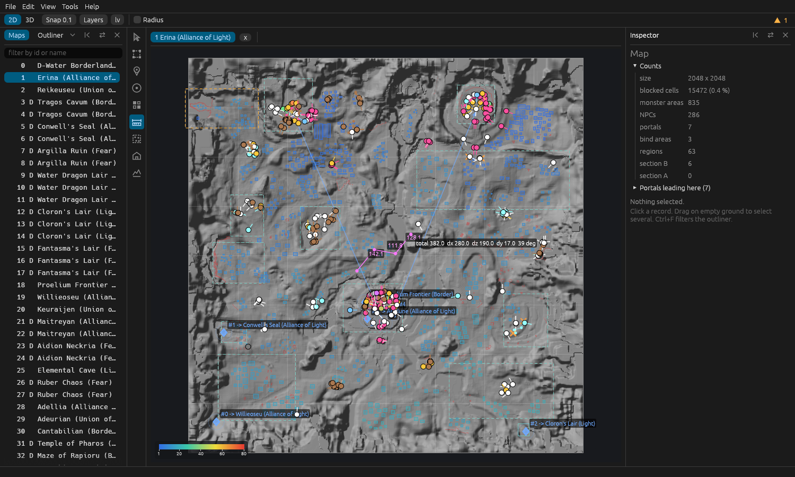

## Selecting and editing

### Selecting

- Click a record to select it. Shift+click adds to the selection, Alt+click cycles through records that lie on top of each other.
- Dragging on empty ground draws a band; everything in it is selected.
- The eye and the lock of each section (in the Outliner and in the Layers popover) hide a section or make it unselectable, so a crowded map stays workable.
- Clicking in the Outliner selects too, and hovering a row outlines the record in the view. Double-click frames the record. Hovering a row of Problems or Find outlines the record too.
- **Edit > Select all** (Ctrl+A), **Edit > Select similar** and **Edit > Select matching...** select many at once, see Find in all maps.
- **Edit > Filter outliner** (Ctrl+F) jumps to the outliner's filter box.

### Moving and changing

- Drag a record to move it; the position snaps to the **snap** step in the toolbar (0.1, 0.5, 1 ... 64; change the list in **Edit > Preferences...**). Shift while dragging a rotation snaps to 15 degrees.
- The arrow keys nudge the selection by the snap step, Shift makes it ten times that.
- With the client open, a dragged NPC, portal, region or bind area moves its client copy too. Alt+drag moves the server map only.
- Boxes have eight handles to resize; an NPC has a ring to turn it; the dots of an NPC's path move on their own.
- **ground on move** keeps the height (off) or drops the moved records onto the ground (on). **Edit > Drop to ground** (G) does it for the selection. A new record always gets the ground height.
- The Inspector holds every field as typed numbers. Typing in one field is one undo step. A value is only rewritten when you touch that field, and then rounded to two decimals.

### Copy, paste, undo

- **Edit > Copy** (Ctrl+C), **Edit > Paste** (Ctrl+V) and **Edit > Duplicate** (Ctrl+D) work across maps: copy in one tab, paste in another. Paste lands at the cursor; **Edit > Paste in place** (Ctrl+Shift+V) puts the records exactly where they were copied from.
- Copy also puts the records on the system clipboard as JSON text. Ctrl+V pastes that text, so records travel between two editor windows, a chat or a git commit. Text that is not records is ignored with a note.
- **Edit > Delete** (Del) removes the selection.
- **Edit > Undo** (Ctrl+Z) and **Edit > Redo** (Ctrl+Y) are per map. The **Changes** tab of the Dock lists the steps of the map and the difference to the file as it was opened or last saved.

### Several records at once

Select records of one section and the Inspector shows batch fields. A field shows the value they all share. It stays empty with the word "mixed" when they differ. Typing a number sets it on all of them as one undo step.

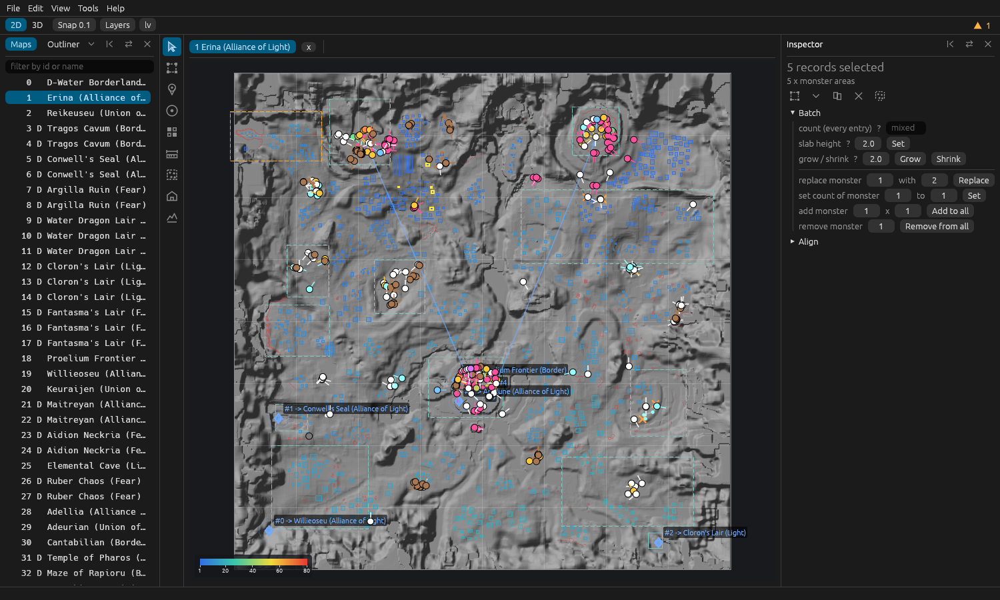

- Monster areas: the count of every entry, the slab height, grow or shrink, replace a monster, set the count of one monster, add a monster, remove a monster.
- NPCs: type, type id, facing. Portals: country and the two levels. Bind areas: country and attr. Regions: kind.
- With records of different sections only the common actions are offered: move, drop to ground, duplicate, delete, align.

Two or more records also get an **Align** section. It has left, right, north, south, centre x and centre z. **distribute x / z** needs three or more records and makes equal gaps. The two outermost stay. Use **snap to grid** to round the position of each record to the snap step. Use **same size as first** to give every box the first box's width and depth around its own centre.

### Scatter monster areas

Press **7** (the Scatter tool) to fill a region with monster areas in one step. Drag a rectangle, or click points for a polygon (Enter, a double-click or a click on the first point closes it; Backspace takes the last point back; Esc cancels). **Fill selection** uses the selected monster areas, bind areas and regions as the region. In the toolbar row pick the monsters with **+**. Each shows as a chip with a weight; click the chip to change the weight or remove it. **From template** copies a template's monsters. Pick a preset: **Sparse**, **Normal**, **Dense** or Custom (spacing, box size and count). A seed sets the layout, and the dice picks another. Tick **avoid blocked** to skip boxes on blocked cells. Tick **keep clear of areas** to skip boxes near existing areas. Tick **two kinds per box** to add a second monster to one box in four.

The preview is green boxes with their counts and a summary line: areas, monsters, level range and points skipped on blocked ground. The same seed always gives the same layout. **R** picks another seed (Reseed). **Enter** or **Apply** adds the areas as one undo step, at the end of the monster areas, and selects them; Esc cancels. Each box stands on the lowest ground under it and is 2 units high. A scatter is capped at 2,000 areas. With the heatmap on, the preview counts in it. Scatter works in 2D only, and not on a read-only tab.

### Bulk edit spawns

**Tools > Spawns > Bulk edit...** opens a window with a rule: a condition and an action on one line, for example `map:1-5 mob:12 => count +1`. The condition uses the words of Find on monster areas, plus `map:` and `count:`. The action is one of `count +n`, `count -n`, `count = n`, `count * f`, `replace X with Y`, `add X *n`, `remove X`, `delete`, `grow d`, `shrink d` or `slab h`. A count action changes only the monsters named by `mob:` words, or every monster when there are none. Counts stay between 1 and 8 unless **allow above 8** is ticked. A count that falls to 0 removes the monster. An area left without monsters stays; Problems calls it `area-empty`.

The preview lists one row per map: areas matched, monsters changed, monsters before and after, and what was held at 8 or left empty. Expand a map to see each area (click one to open and frame it). On the open map the matched areas get a cyan outline. **Apply** makes one undo step per map, named "bulk: " and the rule. It opens the maps it needs. A map that is only open read-only is skipped and named in the summary. Nothing is saved: use **Save all**. Type a name and press **Save rule** to keep a rule; the saved rules are listed in the window. **Replace monster...** in Find opens this window with the replace action filled in.

### Templates

Select one monster area and press **Save as template...** in the Inspector to keep its monsters, size and height under a name. With the Box tool set to draw monster areas, the toolbar's **template** list picks one. A drag then draws a box with the template's monsters. A click without dragging stamps a box of the template's size, centred at the snapped cursor, standing on the ground. The list shows the size and, with the client open, the level. **x** next to it deletes a template. Templates are kept in the settings.

### The context menu

Right-click without dragging. A drag still pans. On a record the menu offers Frame, Copy, Duplicate, Delete, Drop to ground, Select similar, the fixes of its problems, Copy position and Copy GM move command. A portal also has Go to destination. A monster area also has Save as template. On empty ground it offers Paste here, Add area here, Add NPC here, Add bookmark here, Copy position, Copy GM move command and Go to. Add area here says which template it uses, for example "Add area here (Wolves)". Without a template it adds a 16 x 16 box. A read-only tab greys the entries that edit.

### Tabs

Every map you open gets a tab with its own undo history and camera. **View > Next tab** (Ctrl+Tab) and **View > Previous tab** (Ctrl+Shift+Tab) move between them; **File > Close tab** (Ctrl+W) closes one and asks when it has unsaved changes.

Right-click a tab for its menu: Close, Close others, Close saved, Copy path, Reveal in Explorer, Open read-only copy, Compare with reference and Open reference copy. Close others and Close saved never close a tab with unsaved changes.

A **read-only tab** is for looking and copying. You can select, measure and copy records, and compare. Every edit is refused with a note ("read-only tab: use Copy, then paste into an editable tab"). Nothing can be saved. The tab says "(read-only)". Backups and the reference copy open that way.

## The sections

The file has these sections. The server reads them when a map is loaded; the notes say what it does with each.

### Monster areas

Boxes that spawn monsters. Each entry is a monster and a count (the originals use 1 to 8). The box is coloured by the mean monster level; the label is the total count.

To add one, press 2 (the Box tool), choose "monster area" in the toolbar's draw list and drag a rectangle on the ground. The plus of the section in the Outliner adds one too. In the Inspector, **Add monster** adds an entry and the button with the three dots picks a monster by name. The originals use boxes 2 units high, standing on the ground. **Edit > Drop to ground** (G) does that for a box.

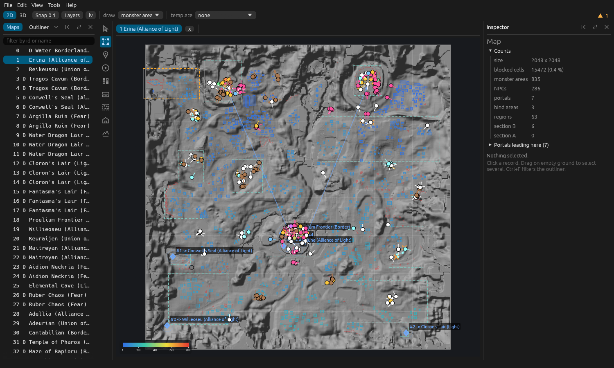

A box whose centre is on a blocked cell gets a warning: monsters cannot walk there.

### NPCs

NPCs have a type (1 merchant ... 13 combat commander, 0 is a placeholder), an id inside that type and one or more points. The first point is where the NPC stands, more points make it walk a path (guards). The pin shows the facing.

Add one with the NPC tool (key 3): set the type and id in the toolbar and click. The inspector has the points table, **Add path point**, and a picker for the NPC by name.

The client's minimap and quest marks use the client's map file. With the client open and the NPC section linked, moving an NPC also moves its record in the client copy of the map. That copy lives in the staging folder. A section is unlinked when the counts differ. A client map that does not write back byte for byte is read-only. In both cases only the server map changes (see Editing the client map with the server map). The client folder itself is never changed.

### Portals

A portal has a position, a country (0 any, 1 Light, 2 Fury, 1001 and up for instances), a level range, a destination map and a destination position. The ring is the 40-unit range in which the server lets a player use it.

The client sends the portal's number (its index in this list) when a player steps in. The server checks that the player is within 40 units (x and z) of the portal at that index in this file. The client's own copy of the map has a portal box at the same index, and the two must match. The editor draws the client's box as a grey ghost and warns (`portal-far`) when you move a portal more than 40 units from it.

Adding, removing or reordering portals changes the indexes the client sends. When the portal list is linked to the client map, the client's boxes change at the same index and the editor asks nothing. When it is not linked, the editor asks first and says what mismatch it creates. See Editing the client map with the server map.

The destination: pick the map in the Inspector, then **Pick on map...** switches to that map and takes one click. **Go to destination** opens the destination map and marks the arrival point. **Drop destination to ground** sets the destination's height from that map's ground. It needs the client data and loads the destination map in the background.

**Tools > Maps > Portal links...** lists every portal of the folder:

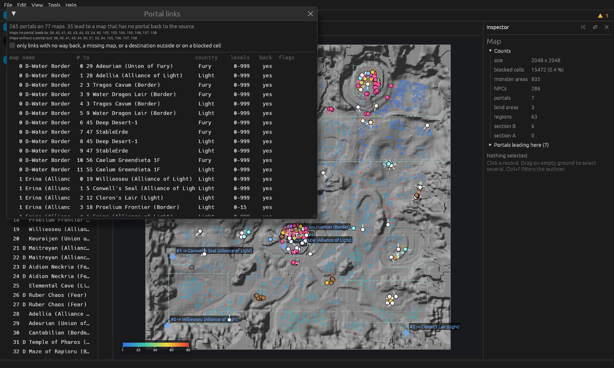

Each row has the source map, the portal number and the destination. Map 200 is the guild ranking and has no file. A row also shows the country, the levels and whether a portal on the destination map leads back ("back"). Flags say that the destination map is missing, or that the destination lies outside the destination map or on a blocked cell. Above the table are the maps no portal leads to, the maps without a portal out, and how many links are one-way. Double-click a row to open the map and select the portal. With nothing selected the Inspector's map card lists **Portals leading here**, with links.

The client's file may have NPCs, portals, regions or bind areas that this file lacks or has differently. **Tools > Client > Sync from client...** lists the differences per section and copies what you tick as one undo step. **Tools > Client > Sync selected record from client** does that for the one selected record.

### Bind areas

Respawn areas: a player who dies respawns in the nearest bind area of their country (0 and 3 both factions, 1 Light, 2 Fury). Each has one or more boxes. Draw them with the Box tool set to "bind area".

### Regions

Named areas: when a player walks into one the client shows its name (some show a picture). The names and boxes come from the client's file by index; the server does not use regions any further. The client expects the same count. A linked list changes both sides. An unlinked list asks first.

### Blocked cells

A grid with one bit per cell (1 unit square): blocked cells stop monsters and guards from walking there. The server does not check players against it. Fields are almost entirely free; dungeons are 40 to 98 % blocked, with the corridors free.

Paint them with the Paint-blocked tool (key 5). The left button blocks, the right button frees, and `[` and `]` change the brush. The toolbar has the modes brush, rectangle, flood fill and invert rectangle, and the buttons "fill map" and "clear map". Every stroke is one undo step.

**Tools > Client > Generate blocked cells...** works the blocked cells out from the dungeon's collision mesh or from the terrain slope. It always shows a preview before you apply it: green will be freed, red will be blocked. The dungeon generator is experimental. On the three dungeons it was checked against, it agreed with the original grid on 93 to 99.5 % of the cells.

### Sections A and B

Their meaning is unknown. Section B is a short list of points (0 to 8 in the originals; the community calls them ladders); section A is empty in every original map. The editor shows both as raw fields so you can keep them or edit them.

### Size

The map's side in cells. It cannot be edited on an open map (it would break the blocked grid and the match with the client). To make a map of another size, use **File > New from client map...**.

## Workflows

### 1. Add a monster area

Goal: a new spawn box with monsters.

1. Open the map: **File > Quick open map...** (Ctrl+P), type its number.
2. Press 2 for the Box tool and choose "monster area" in the toolbar's draw list.
3. Drag a rectangle on the ground.
4. In the inspector click **Add monster**, then the button with the three dots to pick the monster by name, and set the count (1 to 8).
5. Press G to drop the box onto the ground (a slab 2 units high, like the originals).

Check: the box has a colour (its level) and Problems shows no `area-empty` or `mob-unknown`. Watch out: monsters cannot walk on blocked cells, so a box centre on one gets `area-on-blocked`.

### 2. Move a portal or change where it leads

Goal: a portal in another place, or leading somewhere else.

1. Select the portal: click its centre, or its row in the outliner.
2. Drag it, staying inside the grey ghost box: the client's portal at the same index must be within 40 units, or the server refuses the step (`portal-far`).
3. For the destination, use the map list in the inspector, then **Pick on map...** and click the spot.

Check: Problems shows no `portal-far`. Watch out: adding, removing or reordering portals changes the index the client sends. The editor asks first only when the portal list is not linked to the client map. When it is linked, the client's boxes change at the same index and nothing is asked. A linked portal edit also moves the portal box of the client copy. That copy waits in the staging folder until you share it (see Sharing your client changes).

### 3. Make a new map

Goal: a map file for a client map that has none yet.

1. **File > New from client map...**, pick the client map. Check the suggested size (for dungeons it is only a suggestion; some originals use 1024).
2. For a dungeon, look at the preview of the generated blocked cells and apply it.
3. NPCs, portals, regions and bind areas are copied from the client; add the monster areas (workflow 1).
4. **File > Save as...** into the server map folder as `<number>.svmap`.

Check: no errors in Problems. Watch out: the server also needs the map in its `Map.ini`. **Tools > Maps > Add a map...** does all of this in one go, with the client files and the zone (page Adding a map).

### 4. Paint blocked cells

Goal: stop monsters from walking somewhere.

1. Turn on the blocked cells layer and press 5 for the Paint tool.
2. `[` and `]` change the brush size; the left button blocks, the right button frees; the toolbar has the rectangle, flood fill and invert modes.
3. For a dungeon use **Tools > Client > Generate blocked cells...** and look at the preview.

Check: the red overlay is where you want it. Watch out: blocked cells only steer monsters and guards; the server does not check players.

### 5. Check and save

Goal: a file the server loads correctly.

1. Read Problems: errors mean the server loads the map wrongly or players cannot use it; warnings are unlike every original file; info is for your eyes. Click a row to see the record, and use **Fix** where a button is offered (workflow 10).
2. **File > Save** (Ctrl+S) saves safely: it writes a temporary file, reads it back, keeps the `.bak` and replaces the file. If there are errors it asks first.
3. On the server: restart the game server so it reads the files again, or run your server's map import (Afterglow: `tools/world/import.py`).

Check: the tab's dot is gone. Watch out: the client folder you read from is never changed by this. Client files you edited wait in the staging folder.

### 6. Copy monster areas from one map to another

Goal: reuse spawn boxes.

1. Select the boxes (click, Shift+click, drag a band, or **Edit > Select matching...** / **Edit > Select similar**).
2. **Edit > Copy** (Ctrl+C), switch to the other map's tab, **Edit > Paste** (Ctrl+V) at the cursor, or **Edit > Paste in place** (Ctrl+Shift+V) to keep the position.

Check: Problems for `mob-unknown` and blocked-cell warnings on the new map. Watch out: the client mirrors the count and order of portals and regions, so pasted ones ask first.

### 7. Replace a monster everywhere

Goal: swap one monster for another in every spawn box of every map.

1. **Edit > Find in all maps...** (Ctrl+Shift+F) and type `mob:` and the monster's number (for example `mob:2008`); the results are the areas that have it.
2. **Replace monster...** opens **Bulk edit spawns** with the rule `mob:2008 => replace 2008 with 2008`. Click the **Pick** button after "with" and pick the new monster by name or number. The preview says "41 areas match on 6 maps".
3. **Apply**. Each map opens in a tab, or its open tab is used, with one undo step. A map that is only open as a read-only tab is skipped and named in the summary. Nothing is saved yet.
4. Look at the tabs, then **Save all** (the button under the Find box, or **File > Save all**).

Check: Find again with the old monster finds nothing; **Edit > Undo** in a tab takes that map back. Watch out: the replace only touches the areas in the results, so add words (`mob:2008 apulune`) to limit it; the new monster should exist in the client's Monster.SData (`mob-unknown`).

### 8. Compare with the original and undo one change

Goal: see everything you changed against the untouched map, and take back one thing without undoing the rest.

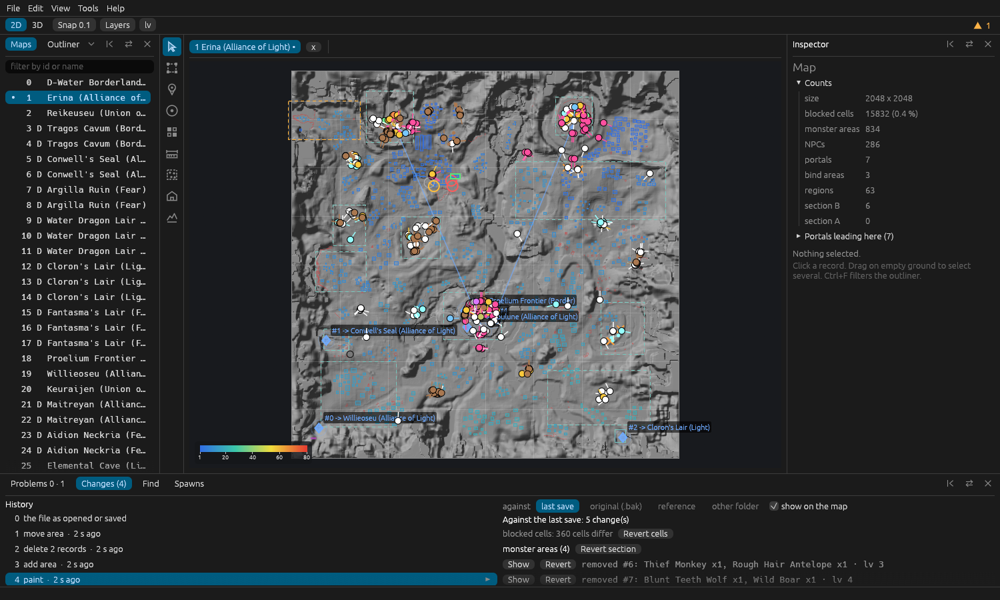

1. Open the **Changes** tab of the Dock. Next to "against" pick **original (.bak)**, the file as it was before the editor's first save, or **reference**, the same map in the reference folder from the setup. A choice that cannot be used says why when you hover it.
2. The **compare** layer switches on. Red dashed boxes are records you removed. Green outlines are ones you added. Amber outlines are ones you changed, with a thin line from the old place. Purple cells are blocked cells that differ. Hover one for what changed.
3. In the list, **Show** selects a row's record and frames it. **Revert** puts that one record back the way the original has it. **Revert section** does the same for a whole section, and **Revert cells** for the blocked cells.

Check: the row disappears and the map matches the original there. Every revert is one undo step, so Ctrl+Z takes it back. Watch out: the client mirrors the count and order of portals and regions, so a revert that changes how many there are asks first.

### 9. Get work back after a crash

Goal: not lose edits when the editor or the computer stops.

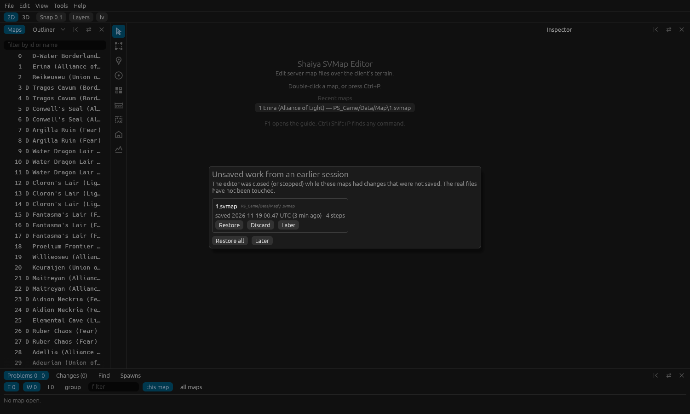

1. Work as usual. About every minute the editor writes what you have not saved into its data folder (never over your file).
2. After a crash, start the editor again: **Unsaved work from an earlier session** lists each map with the time it was kept.
3. Click **Restore** (or **Restore all**). The map opens as a tab with its changes and the modified dot; **Edit > Undo** goes back to the file as it is on disk. Check the result, then **File > Save**.

Check: the recovered copy goes away when you save or discard it. Watch out: "the file on disk changed since" means another program saved the file meanwhile; compare before you save. **Later** keeps the work for the next start, **Discard** deletes it.

### 10. Fix a problem with one click

Goal: clear a finding without hunting for the record.

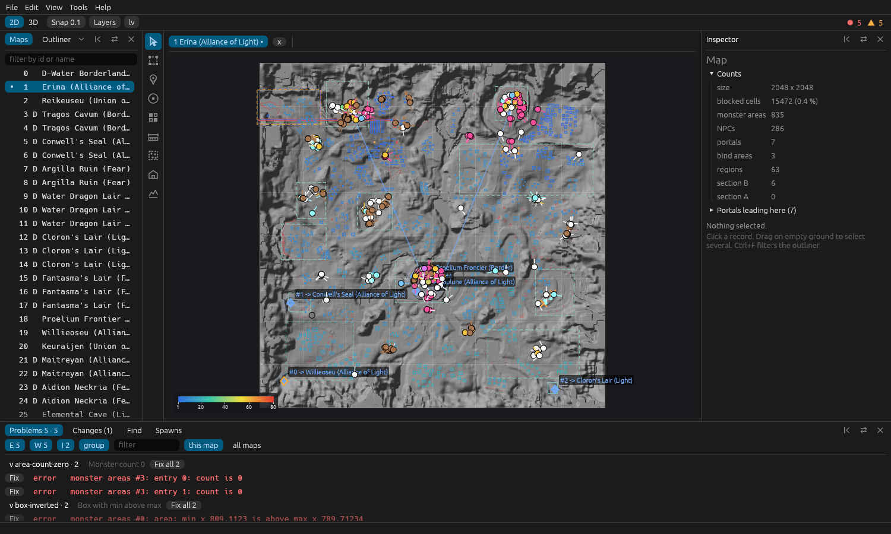

1. In the Problems tab, switch on **group** to see the findings per rule.
2. A row with a **Fix** button can be repaired: the button's tooltip says how. A row with several ways has a menu arrow on its button. Click it; it is one undo step.
3. A group header with **Fix all N** repairs every finding of that rule on this map after asking once.

Check: the finding is gone from the list. Watch out: a fix like "Pick a monster..." only opens the picker, and a fix never adds or removes portals or regions.

### 11. Check a map's spawns

Goal: see whether the monsters of a map fit its levels.

1. Open the map and pick **Tools > Spawns > Spawn check**. The Dock opens on the Spawns tab.
2. Read the level range. Press **H** twice to see the level heatmap: a patch of the wrong colour is a monster out of place.
3. Open **Level outside the map's range** and click the rows. Each one selects and frames the area.
4. Fix an area in the Inspector, or select the group and press Delete for areas you do not want.

Check: the finding is gone from the list. Watch out: a range from few monsters is a guess. Set your own with **Edit** when you know the intended levels.

### 12. Fill a region with monsters

Goal: spawn boxes over an empty stretch of ground.

1. Open the map and press **7**. Drag a rectangle over the ground, or click the corners of a polygon and press Enter.
2. Add monsters with **+** and pick **Normal**. Read the summary line; press **R** until the layout looks right.
3. Press **Enter** to apply. Press **H** to see the new density; Ctrl+Z takes it all back.

Check: the Spawns tab shows no new level findings. Watch out: pick monsters whose levels fit the map, or the Spawns tab lists them as "Level outside the map's range". The boxes keep clear of the existing areas only while **keep clear of areas** is on.

### 13. Change many spawns with a rule

Goal: one change on many maps, for example one more of monster 12 on maps 1 to 5.

1. **Tools > Spawns > Bulk edit...** and type `map:1-5 mob:12 => count +1`.
2. Read the preview: areas and monsters per map. Open a map row to see each area.
3. **Apply**, look at the tabs, then **Save all**.

Check: Find `map:1-5 mob:12` shows the new counts; Ctrl+Z in a tab takes that map back. Watch out: counts stop at 8 unless you tick **allow above 8**.

### 14. Bring changes over from another folder

Goal: take what a copy of the map folder changed into the folder you edit.

1. **Tools > Maps > Compare folders...** Pick the other folder and press **Compare**.
2. Double-click a row that differs, or press **Open pair**. The Changes tab shows the differences.
3. Press **Take** on the records you want, or **Take whole map**. Press **Save** when the map looks right.
4. For a map only the other folder has, press **Copy into this folder** and save it.

Check: the row reads **same** after a new **Compare**. Watch out: Take works one way, from the other folder into this one. Portals and regions that change their count ask first.

## Checking and saving

### Problems

The Problems tab of the Dock lists what the checks found, worst first: errors (red), warnings (orange) and info (grey). The chips **E**, **W** and **I** show the counts. Click one to hide that kind. Hover a row for what the rule means and how to fix it. Click it to select and frame the record. Four groups of rules run:

- the file rules, on the file alone (positions inside the map, boxes the right way round, counts, levels);
- the cross-map rules, when a folder is open (a portal's destination map exists and the destination is inside it);
- the client rules, when the client data is open (monsters and NPCs exist, the size, portals, NPCs, regions and bind areas match the client's copy of the map);
- the server and client rules, when the server data folder is known: the map list, the NPC tables and the client's files agree (see Server and client checks).

The client rules also report an info when a client map cannot be written back (see Client map files and the staging folder). The full list is under Problems explained. The problems chip at the right of the toolbar shows the counts for the open map. Click it to open the Problems tab, and again to collapse the Dock.

**group** lists the findings under one header per rule. Click a header to fold it. The box next to it filters by rule, message, section or `#index`.

**Fix** buttons: a finding that can be repaired has a **Fix** button. It has a menu arrow when there is more than one way. One click is one undo step, labelled "fix: ... (#index)". The Inspector shows the same buttons for the selected record's findings. Some fixes act at once. They clamp inside the map, swap min and max, set a count, swap levels or set the country. Others move a record to the nearest free cell, move a portal to the client's portal box or take the client's value. Some fixes open something: a picker for a monster, an NPC or a destination, or Sync from client. One fix deletes the record. A group header with **Fix all N** repairs every finding of that rule on the open map as one undo step, after asking once. Fixes never change how many portals or regions there are, or their order.

**all maps** (next to the filters) checks every map of the open folder in the background, with open maps counted as they are now. The rows start with the map number and name; click one to open the map and select the record. The map list then shows a badge such as `2 E · 5 W` after each map's name. The totals are the ones `shaiya svmap check <folder> --client <client>` prints.

### The Spawns tab

The Spawns tab of the Dock checks the monster spawns of a map and of the whole folder. Open it with **Tools > Spawns > Spawn check**. Nothing here is a validation rule: Problems and the `check` tool do not change.

**this map** shows three things. The **level range** is where the map's monsters live. No game file holds one, so the editor works it out from the map's own spawns: the 10th to the 90th percentile of the monster levels, weighted by count. A map with fewer than 5 monster entries that have a level has no range. **Edit** next to the range sets your own. **Reset** goes back. The tooltip also shows the level limits of the portals that lead into the map. The **spawn table** lists each monster of the map with its level, areas, total count and share of the map's monsters. Click a column name to sort. Click a row to select its areas. Double-click it to find the monster in all maps. A triangle marks a monster that has a finding. The **findings** are grouped:

- **Level outside the map's range**: a monster whose level is below or above the range by more than the tolerance. The tolerance is 5 levels at first. The box in the header changes it.
- **Strays**: a monster with one or two areas here whose other areas are mostly (80 % of its count) on one other map.
- **Duplicate areas**: two areas with the same box and the same monsters.
- **Mixed levels**: one area with monsters more than 10 levels apart.
- **Unknown level**: a monster with no level in `Monster.SData`, or not in it.

Click a finding to select and frame it. **Select all** on a group header selects every area of that group on the open map. Without the client data only duplicate areas and strays are checked.

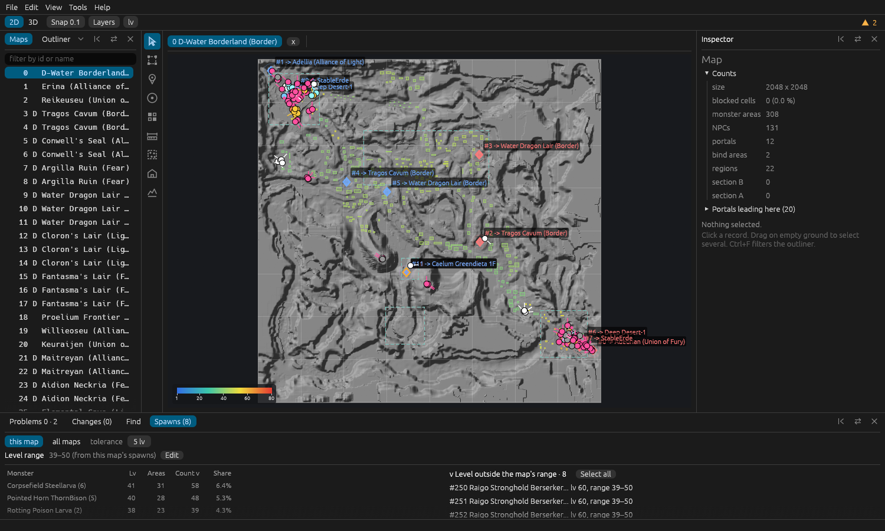

**all maps** adds three views. **Maps** has one row per map with its areas, monsters, kinds, range and findings count; click a map to open it. **Findings** lists the findings of every map. **Never spawned** lists the monsters in `Monster.SData` that have a name and a level but are in no monster area of any map. It filters by name, id and level, and **Copy ids** copies the list. Bosses, obelisks and scripted spawns live in other files, so some of these monsters do spawn in the game.

The folder scope counts every map of the folder, with open maps as they are now. `shaiya svmap spawns` prints the same numbers.

### History

The left half of the **Changes** tab lists the steps you made, in order, with how long ago each was. Click a step to go back to that point. Steps you undid are shown greyed, and clicking one goes forward to it. It is undo or redo until there. "0 the file as opened or saved" is the start.

### Compare and revert

The right half of the **Changes** tab lists what differs from a reference, chosen next to "against":

- **last save**: the map as it was loaded or last saved;
- **original (.bak)**: the `<number>.svmap.bak` the first save made, which is the file as it was before the editor touched it;
- **reference**: the same map in the reference folder (see Getting started).
- **other folder**: the same map in the other folder of Compare folders. It is the only source whose buttons read **Take**.

Each row has **Show** and **Revert**; each section has **Revert section**, and differing blocked cells have **Revert cells**. A removed record is put back where it was, an added one is removed, a changed one is replaced by the reference's. Every revert is one undo step. The **compare** layer draws the differences over the map (see Moving around).

### Compare folders

**Tools > Maps > Compare folders...** opens a tab that sets this folder against another one, map by map. Pick the other folder, which starts as the reference folder, and press **Compare**.

Every map number of either folder gets a row:

- **same**: the files are equal.
- **differs**: the counts per section, for example `areas +2 -1 ~4 · npcs ~1 · cells 312`. A plus counts records only here, a minus records only there and a tilde records that changed.
- **only here** and **only there**: the map is in one folder only.
- **unreadable**: the error says why.

The chips above the list hide a kind of row.

**Open pair** opens the map in an editable tab with its Changes tab set to **other folder**. The buttons then read **Take**, **Take section** and **Take cells**. **Take whole map** makes the map equal to the other copy. Each one is one undo step. Taking portals or regions that changes their count asks first. Nothing is saved until you save.

For a map only there, **Copy into this folder** opens a new unsaved tab. **File > Save** asks for the file name with `<this folder>\<number>.svmap` filled in. **Open read-only** shows the other file to look at.

The direction is one way, from the other folder into this one. To go the other way, open the other folder. `shaiya svmap diff <folderA> <folderB>` prints the same rows.

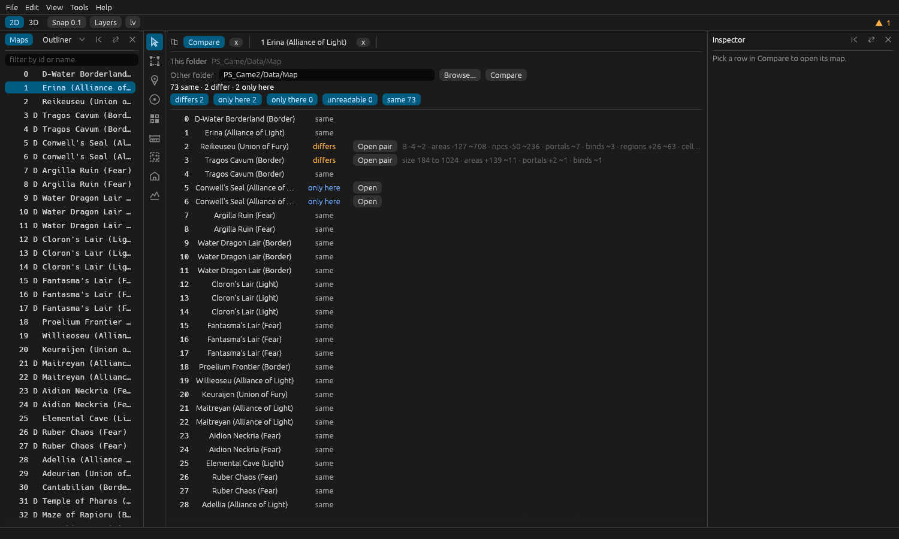

### Saving

**File > Save** (Ctrl+S) writes `<file>.tmp`, reads it back and checks it, copies the original to `<file>.bak` the first time (an existing `.bak` is never replaced), then replaces the file. Then it reads the saved file once more and compares it with the map. The toast and the status bar say **Saved and verified**. On a difference the tab stays modified, the backup stays and the message lists the records that differ. If the file changed on disk since you opened it, or the map has errors, the editor asks before saving. **File > Save as...** (Ctrl+Shift+S) writes anywhere. **File > Save all** (Ctrl+Alt+S) saves every map with unsaved changes, one after the other, each through the same checks; it stops at the first Cancel.

Opening a file and saving it without changes gives exactly the same bytes.

When you close a tab or the window with unsaved changes, the editor asks: Save, Discard or Cancel.

### Backups

Before every save of a map that already has a file, the editor copies the file it is about to replace into its data folder (`backups\...`). The copy is named with the time in UTC. It is skipped when the newest backup has the same bytes. The newest 20 per map are kept. Change that in **Edit > Preferences...**; 0 turns backups off. **File > Restore from backup...** lists them with how they differ from the open map. **Open read-only** opens one as a tab to look at and copy from. **Restore into this tab** makes the map look like it as one undo step. Nothing is saved until you save. If a backup cannot be written, the save stops and asks whether to save without one.

### The file changed on disk

Every couple of seconds the editor looks at the files of the open maps. When another program changed one, a yellow bar appears over that map. **Reload** reads the file again and drops your unsaved changes. **Keep mine** hides the bar. Saving still asks before it overwrites the newer file.

### Autosave and recovery

About every minute the editor writes the unsaved changes of each modified map into the data folder (`recovery\...`), never over your file. The interval is in **Edit > Preferences...**; 0 turns it off. The entry goes when you save, discard or close the map. If the editor crashes before that, the next start shows **Unsaved work from an earlier session** with **Restore**, **Discard** and **Later** per map and **Restore all**. See workflow 9. A second editor window running at the same time is not mistaken for a crash.

### Export

**File > Export > Monster areas CSV...** and its siblings for NPCs, portals, bind areas and regions write one section of the open map as a CSV file. The file is UTF-8 with a byte order mark and CRLF line ends, so Excel opens it directly. The areas file has one row per monster entry, with monster names and levels when the client data is open. **File > Export > All sections CSV...** writes the five files into a folder. **File > Export > Folder monster areas CSV...** puts the areas of every map into one file with the map number first. **File > Export > Map JSON...** writes the same document as `shaiya svmap dump --json`. **File > Export > View as PNG...** saves the 2D view as a picture without handles, hover outline, overview or legend. Text that starts with `=`, `+`, `-` or `@` gets a leading quote, so a spreadsheet does not run it as a formula. Exports never change the map. They refuse to write a `.svmap`, `.sah` or `.saf` file, or any map file that is open or in the folder.

### After saving

Saving writes the `.svmap` file. The server reads it again when it is restarted, or when your server's map import runs (the Afterglow server: `tools/world/import.py`). The client's copy of each map (`world/<number>.wld`) is a different file. Portals, NPCs and regions that must agree with it are flagged in Problems. With the client open, Ctrl+S also writes that copy to the staging folder. See Editing the client map with the server map.

## Server and client checks

These checks compare your map folder with the client and with the server's own data files. They only read. No file changes.

**What you need.** The map folder, the client folder and the server data folder. That is the folder with `Map.ini`, `MapWar.ini`, `NpcQuest.SData` and `Obelisk.ini`, usually the parent of the `Map` folder. The editor uses the parent of the map folder when it holds `Map.ini`. Otherwise set the folder in **Edit > Preferences...** on the Folders tab. Without a server data folder these rules are off, and the Problems tab says so.

**Where they show.** Pick the **all maps** scope in Problems. The group **Server and client** comes first, above the maps. A finding that names a map starts with its number. Click it to open that map. The badges in the map list count these findings too. The totals match `shaiya svmap check <folder> --client <client> --server-data <server data>`.

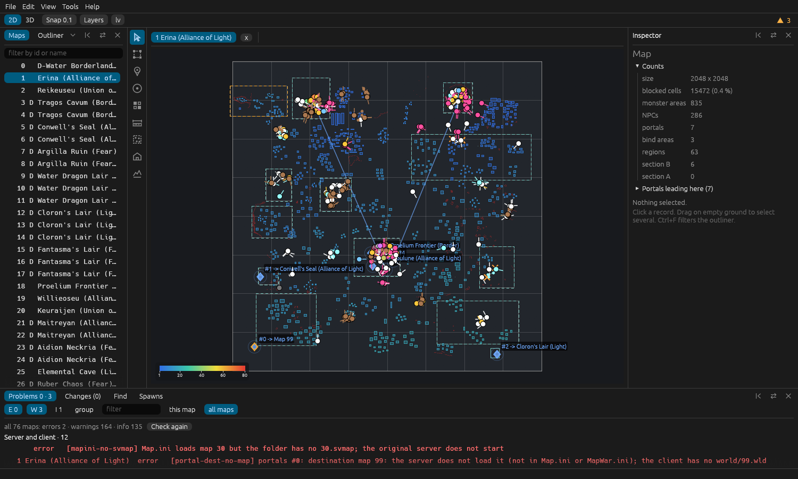

**Target server.** Preferences has a Target server: original or Afterglow. The original server does not start when an id below `MapCount` has no map file. Afterglow skips that id. The setting only changes the kind of `mapini-no-svmap`: error for the original, info for Afterglow.

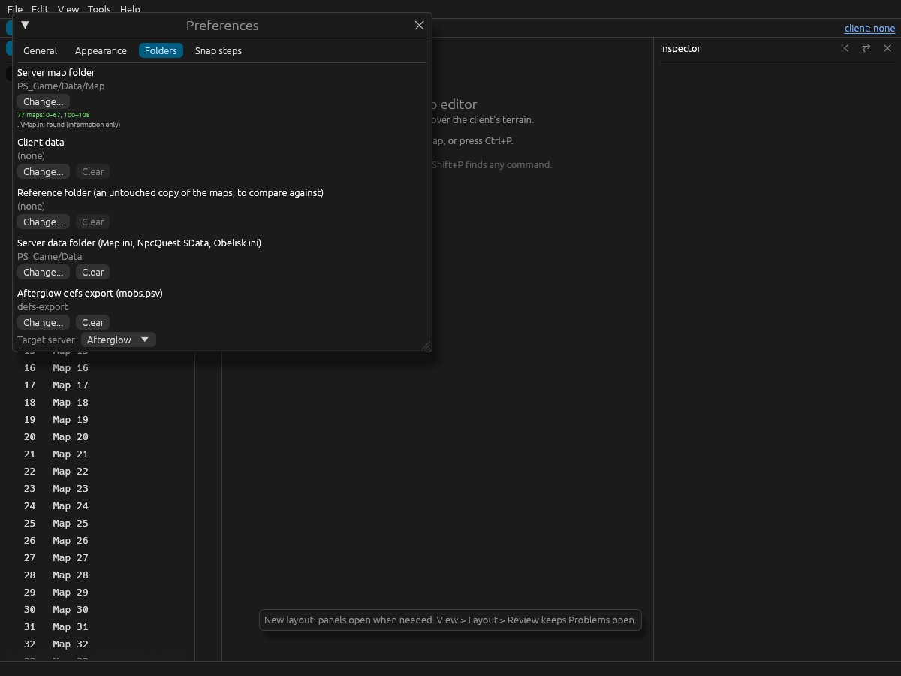

**Monster ids.** The original server keeps its monsters in a database, so there is no list to check against. For Afterglow, set the Afterglow defs export in Preferences to the folder with `mobs.psv`, or to the file. The rule `mob-unknown-server` runs only then.

### Maps and ids

- `portal-dest-no-map`: a portal leads to a map that the server does not load, or that has no `.wld` in the client. Pick a map both have. Portals to map 200, the guild ranking, are skipped.
- `mapini-no-svmap`: `Map.ini` loads the ids 0 to `MapCount` minus 1, and `MapWar.ini` loads 100 and up. An id without its `<id>.svmap` in the folder is a finding. Add the file or lower `MapCount`.
- `svmap-not-loaded`: a map file whose id neither ini file loads. Raise `MapCount`, or ignore the file.
- `mapini-rebirth-outside`: a rebirth position of a zone is outside the map it names, or on a blocked cell. The server ignores a position with map -1 or with x, y and z all 0. So does the check.
- `map-no-client`: the server loads the map and the client has no `world/<id>.wld` for it. Players see nothing or crash.
- `map-no-name`: the map id has no name in sysmsg. The client shows the number. Many dungeons and war maps are like this. The names come from the EP4.5 client's table, so on another client this rule may be wrong (see Verified on and other episodes).

### NPCs and monsters

- `npc-unknown-server`: an NPC of the map (type, id) is not in the server's `NpcQuest.SData`. The server skips it without a message.
- `npc-client-server-differ`: the server and client records of an NPC differ in model, move distance, move speed, faction, or the gates, positions and costs of a gatekeeper. The names may differ, as the two files use different languages.
- `gate-dest-invalid`: a gatekeeper sends players to a map that does not exist, or to a position outside it. The finding names the table, the gatekeeper and the gate.
- `mob-unknown-server`: a monster id is not in the Afterglow export.

### Client files

- `wld-ref-missing`: the `.wld` names a file that the client does not have. The editor looks for models in `Entity/Building`, `Entity/Shape` and `Entity/Tree`, terrain textures, the water file, the sky pictures, music in `Sound/Music` and ambient sounds in `Sound/back`. The client plays without a missing music file.
- `dg-missing`: a dungeon map whose `.dg` is not in `world/dungeon`. The map cannot load.
- `minimap-missing`: a field map without `interface/MiniMap/<id>.tga`. Only about 24 maps ship one, so this is info.
- `tactics-zone-map`: an area of the client's `world/TacticsZone.zon` (safe zones and dungeon rooms) names a map that does not exist. The file's placeholder area on map 10000 is skipped. A file that does not read to its last byte is not checked.

### Obelisks and notes

- `obelisk-pos`: an obelisk of `Obelisk.ini` is outside its zone's map or on a blocked cell. Only zones and obelisk positions are read.
- `server-data-note`: a server file is missing or unreadable. The rules that need it did not run. The note names the file.

Check: with the right folders the group lists only what is really wrong. On the original maps with the original client and server files it has no error.

## Client map files and the staging folder

The editor can write a copy of a client map file. It never writes into the client folder it reads from, and so never into its `data.sah` or `data.saf`. This page says where the copy goes and how to learn whether your client can be edited. Getting the copy into a test client is the job of Install (see Sharing your client changes).

### Can my client be edited?

Run `shaiya svmap wld-check <client folder>`. It reads every `world/<number>.wld`, writes it back in memory and compares the bytes. Each file is byte-identical, or the first byte that differs is named. The exit code is 1 when any file is not identical. On the EP4.5 client all 83 files are identical. Another episode's client may differ, and the check tells you before you edit anything. A file that is not identical stays read-only in the editor.

The check matters. The game does not look at the length of a `.wld`. A file that is too short inside `data.saf` reads on into the next file, and the game shows garbage or crashes. So the writer counts every list exactly. It keeps the bytes it does not edit, including the leftover bytes after the end of each name.

### The staging folder

Edited client files go to a staging folder, for example `<folder>/data/world/2.wld`. Set the folder in **Edit > Preferences...** on the Folders tab, or pick it the first time you stage a map. The editor refuses a folder that is the client folder or lies inside it. A link or a network path that leads into the client counts too.

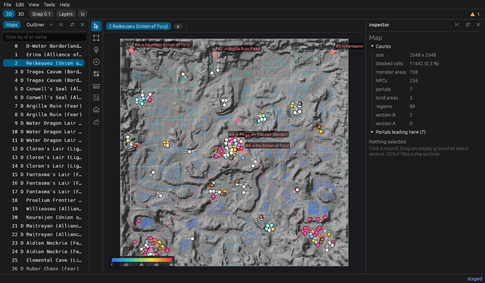

When the editor reads a client file, it looks in the staging folder first. A map that reads its `.wld` from there shows **staged** in the status bar. Clear the folder in Preferences to bring back the client's own copy. The game does not read the staging folder. The game reads `data.sah` first, so a loose file never replaces a file that the archive holds.

### Stage client map

**Tools > Client > Stage client map...** writes the open map's `.wld` to the staging folder. A map without unsaved client changes gets the bytes that were read. A map with client changes is saved like Ctrl+S saves it.

Every write follows the same steps. The editor writes `<file>.tmp`, reads it back, parses it and compares it with its model. Only then does it replace the file. A copy of the replaced file goes to `backups\client` in the data folder, and `<file>.bak` appears beside it the first time. On any difference the file is not replaced and the map stays modified. A read-only file in the staging folder is not replaced either, and the editor says why.

### Read-only client maps

A `.wld` that does not write back byte for byte stays read-only. The status bar shows **client map read-only**. Hover it for the reason. Problems lists the info `wld-not-lossless`. **Stage client map...** refuses the file and says why.

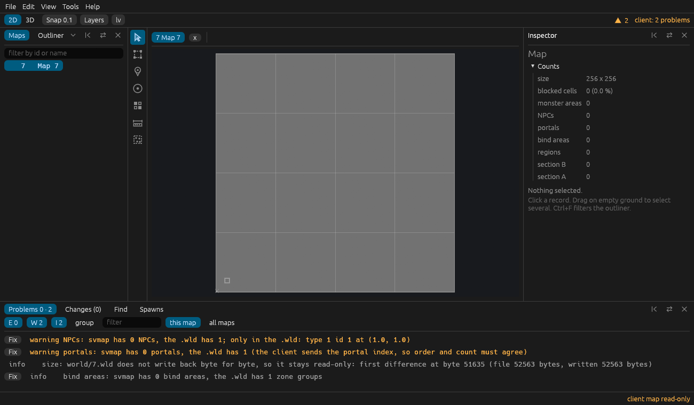

### Code page

The names in a `.wld` use a code page. The EP4 client uses cp949, the default. Another client may use Shift-JIS or GBK. Set the page under **Edit > Preferences...**, Folders tab. The editor uses it for the destination name of a portal.

## Editing the client map with the server map

With the client folder open, each map tab also holds an editable copy of the map's client file: `world/<number>.wld` and `world/<number>.txt`. An edit of an NPC, a portal, a region or a bind area changes both copies in one undo step. Undo, redo, the history, autosave and recovery cover both.

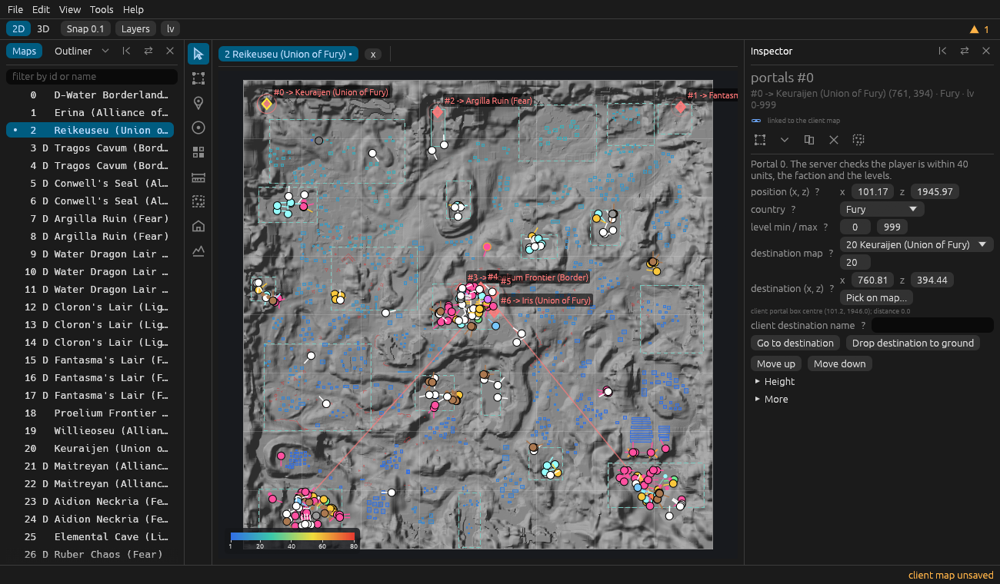

### What is linked

| server map | client map | what moves together |
|---|---|---|
| NPC | NPC record | type, type id, first point, angle, path points |
| portal | portal box | country, levels, destination map and position. The box centre (x, z) and bottom y follow the portal. The box keeps its size. |
| region | named area | box, kind and the three raw values. The name is a line of `<number>.txt`. |
| bind area | zone group | boxes, country, attr |

Monster areas, blocked cells and sections A and B exist only on the server. Buildings, trees, effects, sounds and the sky exist only in the client map. The editor leaves them alone.

An edit copies only the fields you changed. A difference that was already there stays. Moving a portal does not overwrite the client's destination.

### When a section is linked

A section is linked while both lists have the same number of records. Then record 5 on one side is record 5 on the other. A chain icon next to the section name in the Outliner and a row under the heading in the Inspector show it. A grey chain means the counts differ. Edits of an unlinked section change the server map only. Use **Tools > Client > Sync from client...** to bring the counts together.

Some original maps start unlinked: the NPCs of maps 19, 20, 28, 29 and 40, the portals of maps 6, 8, 35 and 36, and the regions of seven maps.

Adding, removing or reordering portals and regions changes both lists at the same index. Only an unlinked section asks first. Reordering portals moves the client boxes with them. Inserting a region renumbers the lines of `<number>.txt` after it, so each name stays with its area.

### Names

The Inspector has two client-only fields. A region has **client name**, line N of `<number>.txt`. A portal has **client destination name**, the text the client shows for the destination. Press Enter or click elsewhere to apply. Each is one undo step.

The destination name is stored in the code page of **Edit > Preferences...** and takes up to 248 bytes. A name that does not fit the page is refused with a message.

### Changing one side only

Hold Alt while you drag a record in the 2D view. Only the server map moves, and a toast says so. The client map stays as it was. Problems then reports the difference. In the 3D view every drag changes both sides.

### Sync in both directions

**Tools > Client > Sync from client...** compares each section with the client map as you have edited it. Every row has a direction. **take client** copies the client's value into the server map. **take server** copies the server map's value into the client map.

For a record that only one side has, **take server** makes the client map match the server map. It adds the record to the client map or removes the extra one. **take client** does the same to the server map. An added NPC goes between the same neighbours as on the other side, so both NPC lists keep one order. The buttons **all take client** and **all take server** set a whole section. Applying is one undo step.

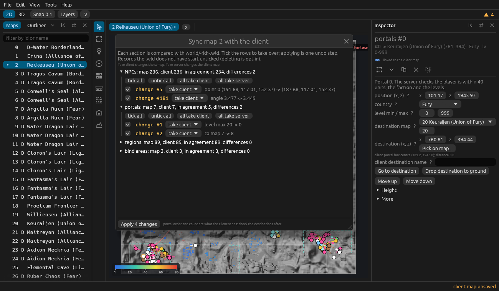

### Saving the client map

Ctrl+S saves the server map first, with all its checks. Then it writes the client files to the staging folder with the verified save of the previous page: `world/<number>.wld`, and `world/<number>.txt` when it changed. The first time, the editor asks for the staging folder. The client folder is never written.

When only the client part changed, Ctrl+S writes just the client files. The status bar shows **client map unsaved** while changes wait. If the client write fails, the server map stays saved and the client part stays modified. The status bar then shows **client map not saved**, and the message gives the reason. Closing the tab asks about unsaved client changes too.

The Changes tab lists what the client part changed. Unsaved client changes go to the recovery folder with the map. Restoring such an entry needs the client folder open.

### Limits

A map whose `.wld` does not write back byte for byte stays read-only on the client side. Its edits change the server map only, and the Inspector says why. This page covers NPCs, portals, regions and bind areas. Buildings, shapes and trees have their own page, and so does terrain.

The staging folder is not the game's folder. Getting the staged files into the game is a later step. Test every edited map on a copy of your client first.

## Buildings, shapes and trees

The Placements tool edits the buildings, shapes, trees and dungeon pieces of the client map. It needs the client folder and a map tab with an editable client map (the chain row in the Inspector says so). Press **8**, or pick **Placements** in the tool strip. These objects exist only in the client map. The server map never changes.

### Select, move and turn

Click a placement to select it. Shift adds or removes one. Alt takes the next one under the cursor. Drag a placement to move it. The preview shows where it will land, and the release is one undo step. On a field the height follows the terrain: a placement keeps its offset from the ground. Press **R** to turn the selection by 15 degrees, **Shift+R** by -15. Esc cancels a drag, then clears the selection.

The Inspector shows the list, the model, the position and the heading. Type a value or drag it. **Snap to ground** sets the height to the terrain under the placement. A dungeon map has no terrain, so nothing snaps there. The floor comes from the `.dg` file.

Turning keeps the two direction vectors of the placement at unit length and square to each other, as every placement of the original maps is. There is no scale.

Picking uses the box of the model's `.smod` file, turned with the placement. A model the client cannot read gets a small stand-in box. Picking works in 2D (the box seen from above) and in 3D (the box under the cursor ray).

### Add, duplicate and delete

Click **Models...** in the toolbar. The window lists the models of the client by kind, with a filter and a picture of the chosen model. The name column has a fixed width. A long name ends in dots, and the hover text shows it whole. The picture shows the model from above with its textures, lit from the upper left, and its visible edges as a light wire. See-through parts of a texture, such as leaves and fences, are left out as in the game. A part without a texture, or whose texture the client does not have, is plain grey. A part whose texture is see-through everywhere, such as the invisible boxes `g1_cbox_*`, shows only as wire, and a line under the picture says so. Hover over the picture to see how much of it is textured and which textures have see-through parts. Click a name, then click the map. Each click adds one placement at that point, facing the heading in the toolbar. Esc or **Stop** ends adding.

Every placement points at a model name by its position in the list of names. The editor never removes or moves a name, so no other placement changes. **Delete** removes only the placement. Adding a model the list already names reuses its entry. A new model is appended at the end of the list, and undo takes the entry back. **Duplicate** (Ctrl+D) copies the selection 2 units aside.

Each edit is one undo step. Ctrl+S writes the client map to the staging folder like the other client edits. The Changes tab counts the changed placements.

### In the 3D view

The tool works in 3D too: click picks, drag moves along the ground, a click with a model chosen adds. The scene draws the edited placements at once. A model that was not in the scene when it was built is loaded as soon as it is added, one model per frame. The placement then shows as the real model. Until then it is a cyan box with the model's name over it. If loading fails, the box stays and the name says "not loaded". Selected placements have a yellow box.

### In the 2D view

Added and moved placements are drawn as dots at once, also when the **buildings and trees** layer is off. With the layer on, every placement is a dot.

### Limits of placements

Grass, vani, mani, effects and sounds are shown and counted. The editor leaves them alone. The model window shows a still picture from one angle. It cannot be turned. Dungeon pieces have no dot in 2D and no model in 3D. Click where one stands, and its box shows once it is selected. Building and placement edits were checked in the game on a US EP4.5 test client, and the edited maps load. Test every edited map on a copy of your client first.

## Terrain

The Terrain tool changes the ground height of a field map's client map. It needs the client folder and a field map tab with an editable client map. Press **9**, or pick **Terrain** in the tool strip. A dungeon has no terrain, so the tool is off there and its tooltip says why. The server map has no heights.

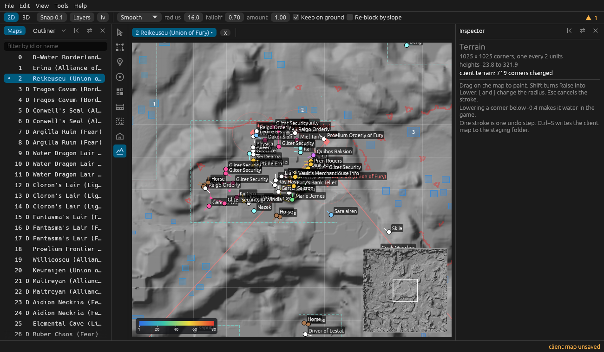

### Brushes

Pick a brush in the toolbar. **Raise** and **Lower** move the corners under the brush. Shift swaps the two. **Flatten** pulls corners to the height where you pressed. **Smooth** averages each corner with its neighbours. **Set height** drives corners to the height in the toolbar. **Ramp** joins the point where you pressed to the point where you release. Drag out a line and the ground between the two points becomes a slope.

The yellow ring shows the radius. The white ring inside it marks where the brush works at full strength. The **falloff** setting moves the white ring. A falloff of 0 is a hard edge and 1 fades from the centre. The **amount** setting sets how strongly a held brush works. The keys **[** and **]** change the radius.

One corner stands every 2 units. Heights are stored in steps of 0.02 from -855 to 455. A brush never writes a value outside that range.

### One stroke, one undo step

Press, drag and release is one stroke. The ground changes while you drag. The release makes one undo step with every corner the stroke moved. Esc during a stroke puts the corners back. So do Ctrl+Z, Ctrl+S, another tool and another tab while the button is down. Undo, redo and the History list move a whole stroke. A click without a drag is one dab.

### Keep records on the ground

**Keep on ground** is on by default. When a stroke changes the ground under a building, shape, tree, NPC point or portal, the height of that record changes by the same amount, in the same undo step. This covers the client map and the server map. Records outside the stroke stay where they are. Turn the option off to change the terrain alone.

**Re-block by slope** is off by default. When it is on, the stroke changes the blocked cells whose slope crossed the angle you set. Cells that become steeper get blocked and cells that become flat get freed. The 2D view previews the change while you drag: red cells block and green cells free. A cell whose slope class did not change keeps its value.

### Terrain in the 3D view

The tool works in 3D too. A drag that starts on the ground paints. A drag that starts in the sky, or an Alt+drag, orbits the camera. Right or middle drag pans. The yellow ring follows the ground under the cursor. The mesh redraws while you drag.

### Water

The game treats a height below -0.4 as water. A stroke that lowers corners below that level says so when it ends. The editor changes nothing else for water. On the test client, ground lowered below that level gave shallow water without swimming.

### Saving terrain edits

Ctrl+S writes the client map to the staging folder like the other client edits. The file keeps its exact length. Only the heights differ from the original, and a stroke that comes back to the starting heights changes nothing. The Changes tab counts the changed corners.

### Limits of terrain

Texture painting is not part of the tool. The 3D view redraws only the parts of the map a stroke touched. The game was checked on a US EP4.5 test client: players walk on a raised hill, and ground lowered below -0.4 gives shallow water without swimming. Test every edited map on a copy of your client first.

## Map.ini

The Map.ini editor changes the zones of the server's `Map.ini` and `MapWar.ini`. Open it with **Tools > Maps > Map.ini editor...**. It needs the server data folder. Set it in **Edit > Preferences...** on the Folders tab. When the map folder sits inside the data folder, the editor finds `Map.ini` by itself.

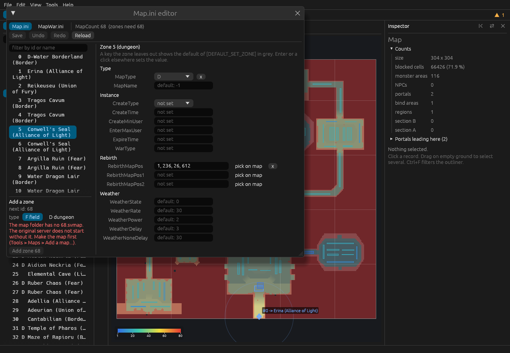

### Zones and keys

The tabs at the top pick the file. `MapWar.ini` shows only when it exists. The list on the left holds one entry per `[SET_ZONE_n]`, with the map's name. The form on the right shows the keys of the zone you picked: the type, the instance keys, three rebirth positions and the weather. Other keys of the zone follow at the end as plain text rows.

Type a value and press Enter, or click elsewhere. Each change is one undo step. The **x** next to a key removes the key line. **Undo** and **Redo** at the top step through the changes of the file you are on.

The editor only writes plain ASCII values. A value cannot hold `//` or `/*`, and it stays on one line.

### Defaults

A key that the zone leaves out shows the value of `[DEFAULT_SET_ZONE]` in grey. The editor assumes the server uses that value for the zone. The original files point that way. It is not confirmed.

### Pick on map

A rebirth position is `map, x, y, z`. Click **pick on map** next to it. The map opens in a tab, and a click on the ground sets the position. Esc cancels. The height is the ground height at the click.

### What stays as it was

The editor keeps every line it does not change, byte for byte. That includes the Korean comments, the line endings and the sample block at the top of the file. A changed value replaces only its own bytes, and a `//` comment after it stays. A new key is a new line after the last key of its zone. A new zone is added at the end of the file.

### Adding a zone

The box at the bottom left adds a `[SET_ZONE_n]`. The rules follow the server.

- The original server loads the ids 0 to `MapCount` - 1 and does not start when one has no map file. So only the next id is offered, and its `.svmap` must be in the map folder first.
- Afterglow skips an id without a map file. Any free id up to 255 works, except 200. The editor warns when the `.svmap` is missing.
- In `MapWar.ini`, only the next war id is offered. Zone `n` there is map `n`, counted from 100.

`MapCount` follows the zones. In `Map.ini` it is the highest zone id plus 1. In `MapWar.ini` it is the number of war maps, the highest id minus 99. Adding zone 109 to `MapWar.ini` gives 10. A new zone never lowers `MapCount`. To make a whole new map, use **Tools > Maps > Add a map...** (page Adding a map).

### Saving Map.ini

**Save** writes the file in the server data folder. It writes a temporary file first, reads it back and compares it. Then it keeps a copy of the old file as `.bak` beside it (once) and as a timestamped copy under `backups\server\` in the editor's data folder. The rename comes last. A save stops when the file changed on disk since the editor read it. Press **Reload** then. Closing the window or the editor asks about unsaved changes.

The editor never writes into the client folder.

### Limits of the Map.ini editor

The editor cannot delete a zone and does not change the `[BASE]` start positions. Unsaved edits are not kept after a crash. The editor does not know the unit of `ExpireTime` or the letters of `CreateType`, so it only checks that they are plain text. An edited `Map.ini` has not been checked live on a server.

## Adding a map

**Tools > Maps > Add a map...** makes a new map in one go. It writes the client map, its area names, a minimap picture, the server map and a zone in `Map.ini`. It needs the client folder, the server map folder and the server data folder. The client files go to the staging folder, which the editor asks for once.

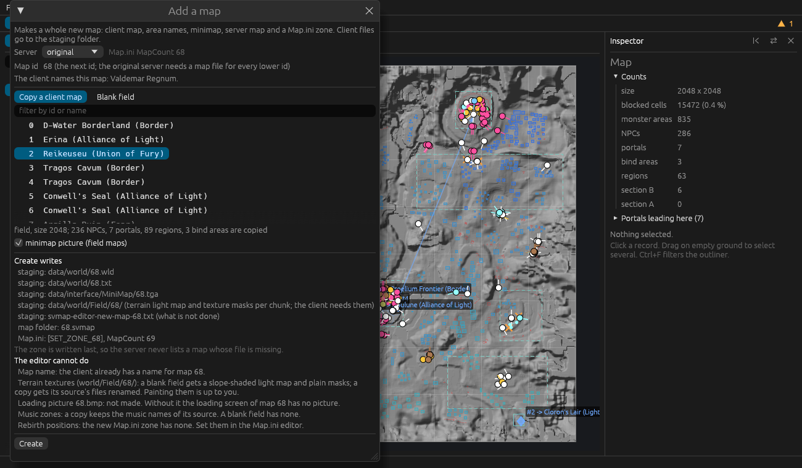

### Pick the server

The **Server** list is the same setting as in the Preferences. The original server takes the next id only, which is `MapCount` of `Map.ini`. Afterglow takes any free id from 0 to 255 except 200. The id 200 is always refused. The window shows why it refuses an id.

Id 70 gets a warning. The client forces the map size 1600 on that id. Ids from 100 to 200 get a warning too. The client refuses some item uses on those maps.

### Source

**Copy a client map** takes the client's map file, its area names, and its NPCs, portals, regions and bind areas for the server map. Monster areas and sections A and B stay empty. A dungeon starts with every cell free. Use **Tools > Client > Generate blocked cells...** afterwards.

**Blank field** makes a flat field of 1024 or 2048 units at height 0. The textures, water, sky and fog come from a field map you name in **look from map**. It has no buildings, NPCs, portals or sounds.

A client map that does not write back byte for byte is not copied.

### What Create writes

The list in the window names every file before you press Create.

1. `data/world/<id>.wld` and `data/world/<id>.txt` in the staging folder.
2. `data/interface/MiniMap/<id>.tga` in the staging folder, for a field map when the box is ticked. It is a 512 x 512 picture shaded from the heights, with the north edge on top.
3. `data/world/Field/<id>/` in the staging folder, for a field map: the terrain textures of every chunk. The client loads `<id>_<row><col>_L.dds` (a light map) and `<id>_<row><col>_A<k>.dds` (one mask per terrain texture). It stops loading with a popup when a light map is missing. A map has `size / 1024` chunks per side. A blank field of 2048 gets 2 x 2 chunks (`00`, `01`, `10`, `11`). A blank field gets a light map shaded from its heights and masks that follow its texture slots. A copy gets its source's files renamed to the new id. If the source has no light map for a chunk, the copy gets a shaded one. A dungeon has no such folder, so none are made.
4. A notes file `svmap-editor-new-map-<id>.txt` in the staging folder, outside `data`. It lists what is not done.
5. `<id>.svmap` in the map folder.
6. The zone in `Map.ini`, with `MapCount`. It goes last, so the server never lists a map whose file is missing.

Every write is checked by reading it back. A file that is already there is never replaced without a copy. If the `.svmap` exists already, nothing is written. If a step fails, the files written before it stay. The window lists them.

### What the editor cannot do

- The map name. The client shows `Map <id>` until a name is added to its text tables, which the editor never edits. Ids 68, 69 and 70 already have names. For other ids the window asks for a name and keeps it in the notes file. Adding it to the game is your choice.
- The loading picture `<id>.bmp`.
- Painted terrain textures. A blank field has a light map that follows the slopes and plain masks. Paint them in your own tools if you want more.
- Music zones. A copy keeps the music names of its source.
- Rebirth positions. Set them in the Map.ini editor.
- For Afterglow: run `tools/world/import.py` again, so the server reads the new map file.

### Pack and try it

The staged files are plain files under `data`. **Tools > Client > Share client changes...** turns them into a patch or installs them into a copy of your client (page Sharing your client changes). Test on a copy first. A new map with id 110, made this way, loaded on the US EP4.5 client and imported on the Afterglow server. Four things have not been checked in the game. They are a blank field of 2048 units, the area banner picture, the order of the lines in `<id>.txt`, and the orientation of the made minimap.

## Sharing your client changes

**Tools > Client > Share client changes...** takes the files in the staging folder and hands them on. It needs the client folder. The window lists the staged files first. Only files the editor wrote are in the list. Backup files (`.bak`) and temporary files (`.tmp`) are left out.

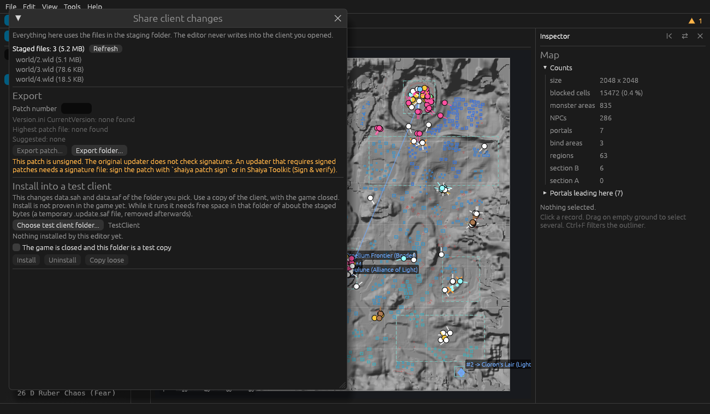

### Export a patch

**Export patch...** writes `psNNNN.patch` into a folder you pick. The number field starts from the client and never from a fixed number. It shows two candidates. The first is the `CurrentVersion` of the client's `Version.ini` plus one. The second is the highest `psNNNN.patch` plus one. That file is looked for in the client folder, its `data` folder and the folder of your last export. It suggests the higher of the two and fills the field with it until you type a number. A candidate that is not found says "none found". When no number can be suggested, the field stays empty and Export patch waits for a number from 1 to 9999. Choosing the export folder counts its patch files too, before the patch is written. A number you typed is kept, and a patch of that number already in the folder stops the export. The file is the format of the game's updater: the staged files, nothing else. The editor reads the new patch back and checks that it lists exactly the staged files. It never replaces a patch that is already in the folder.

The patch is **unsigned**. The original updater does not check signatures. An updater that requires signed patches needs a signature file: sign the patch with `shaiya patch sign` or in Shaiya Toolkit (Sign & verify). The editor does not sign.

**Export folder...** copies the staged files to `data/` in an empty folder. Use it to look at them or to pack them with another tool.

Neither export writes into the client folder you opened. A folder inside it is refused. The editor changes data only. A staged program (a name ending in `.exe` or `.dll`, any case) stops Export patch, Export folder, Install and Copy loose, and the message names it. Remove it from the staging folder first.

### Install into a test client

**Install** changes `data.sah` and `data.saf` of a folder you pick. Use a **copy** of your client, and close the game first.

1. Choose the test client folder. The editor refuses the client folder it reads from and any folder inside it or around it. It also refuses the client folder kept in the settings and the folder in `SHAIYA_CLIENT`. Without `SHAIYA_CLIENT` the editor cannot tell which other folder is your main client. Pick the folder with care.
2. Tick that the game is closed and the folder is a test copy.
3. Press **Install**.

Before the first install the editor copies `data.sah` to `data.sah.svmap-editor`. It never replaces that file while the install lasts. Every install also makes `data.sah.svmap-editor-<UTC time>`. The patch step (`shaiya_patch::apply`) writes `data.sah.bak` on every install and overwrites it, so that one is no backup.

The editor refuses when `data.sah` cannot be read, when `data.saf` cannot be opened for writing, when the game is running, and when the staging folder lies in the target. On Windows a `data.sah` or `data.saf` open in another program stops Install and Uninstall. So does a running `game.exe` of that folder. The message gives the reason. On other systems the editor cannot see whether the game runs. It only checks that the archive files are writable. It adds this line to the result: "Cannot check whether the game is running on this system; make sure it is closed."

If an earlier change by the toolkit was interrupted in that folder, the editor finishes or undoes it first. The editor first checks that the folder is a client and that `data.sah` can be read, and then runs this recovery. Every later step (the install record, the index, the sizes and fingerprints) is read after it. The result says what recovery did. A folder where an interrupted swap left no `data.sah` is refused by the first check and is not recovered by the editor. If recovery is not possible, nothing else is changed.

Install applies the patch with `shaiya-patch`. While it runs, the patch's `update.saf` is unpacked as a temporary file `.update.saf.<number>.shaiya-tmp` in the test client folder, so the folder needs free space of about the staged bytes again. The file is removed afterwards, also when the install fails. The editor also builds the patch in a temporary folder under the system temp folder. That folder holds a copy of the staged files and the file `install.patch`, so it needs free space of about twice the staged bytes. Export patch uses the same temporary folder for the copy. With a large staged set, check the free space on both drives first. The editor keeps no journal (the toolkit's journal is not used here): the first backup of the index and Uninstall are what undo an install. `data.sah.bak` is overwritten by `shaiya-patch` on every install and is not a backup of this editor.

After the patch is applied the editor checks the result. Every staged file must read back byte for byte from `data.saf`. No other entry may move. The old part of `data.saf` must be the same. If a check fails, the old index is put back and `data.saf` is cut back to its old length.

The folder gets a record, `svmap-editor-install.json`, with the sizes and hashes of the files before and after.

Status: Install and Uninstall were run on a copy of a US EP4.5 test client. The staged file read back from `data.saf`. `data.saf` grew by exactly the staged bytes. Uninstall gave back `data.sah` and `data.saf` byte for byte.

### Uninstall

**Uninstall** puts `data.sah` back from `data.sah.svmap-editor` and cuts `data.saf` back to its old length. It checks the result, then removes the record and the first backup. The timestamped copies stay.

Uninstall refuses when `data.sah` changed after the last install, or when the old part of `data.saf` changed. A game update or another tool did that, and restoring would undo it. If `data.saf` grew since, it is not cut. Its extra bytes are harmless. The editor never compacts the archive.

### Copy loose

**Copy loose** is for new maps. It copies a staged file to `data/` in the test client only when the archive has no entry with that path. The game reads the archive first (checked for US EP4.5 patch 108), so a loose copy of an existing path would be ignored. The window refuses those files and says why. It never replaces a file that is already there.

### Bring your own client

The editor ships no game files. It reads only your own client and server files. Exports hold only files you edited. Do not pass on Webzen or Gravity data, and do not put the client's own files into a patch you share. The editor is not affiliated with the game's owners.

## Problems explained

Every rule the editor can report, what it means and what to do. The same text is in the hover tooltip of each row in the Problems tab.

| Rule | Kind | What it means | How to fix it |
|---|---|---|---|
| `pos-out-of-range` | error | Position outside the map. The server only accepts 0 <= x, z < size (CMap::IsSafePos). | Move it inside the map, or clamp the corner inside. |
| `region-out-of-range` | warning | Region corner past the edge. A region corner is past the map edge; the server does not use regions any further (4 original regions do this). | Clamp the corner inside the map, or leave it. |
| `box-inverted` | error | Box with min above max. On one axis the box's min is above its max. | Swap min and max on that axis. |
| `non-finite` | error | NaN or infinity. A number is NaN or infinite. | Select the record and type a real value. |
| `blocked-size` | error | Blocked grid has the wrong length. The blocked grid is not size x size cells: the file is damaged. | Not fixable here; restore the file from a backup. |
| `area-empty` | info | Monster area spawns nothing. The box has no monster entries, so it spawns nothing (61 original areas are like this). | Pick a monster for it, or delete the area. |
| `area-count-zero` | error | Monster count 0. An entry with count 0. | Set the count to 1 or more. |
| `area-count-high` | warning | Monster count above 8. The original files use counts 1 to 8. | Set the count to 8 or less. |
| `area-mob-zero` | warning | Monster id 0. Monster id 0 is the placeholder record "Error Monster". | Pick a real monster. |
| `area-on-blocked` | warning | Monster area centre on a blocked cell. The box centre is on a blocked cell, so monsters there cannot walk. | Move the area onto free ground, or free the cells. |
| `npc-no-points` | error | NPC without points. An NPC needs at least its standing point. | Add a point, or delete the NPC. |
| `npc-type-invalid` | error | NPC type above 13. NPC types run 0 to 13. | Set a valid type. |
| `npc-type-zero` | info | NPC type 0. Type 0 entries are placeholders (58 original entries are like this). | Nothing to do unless it is a mistake. |
| `npc-on-blocked` | warning | NPC on a blocked cell. The NPC's first point is on a blocked cell. | Move the NPC, or free the cell. |
| `portal-levels` | warning | Portal level range reversed. Level min is above level max (and max is not 0). | Swap the two levels. |
| `portal-country` | warning | Portal country unknown. The country is not 0 (any), 1, 2 or an instance id from 1000. | Set the country to 0, 1 or 2. |
| `portal-map-missing` | warning | Destination map not in the folder. The destination map has no file in the open folder (and is not 200, the guild ranking). | Pick another destination, or open the folder that has the map. |
| `portal-dest-outside` | error | Destination outside its map. The destination position is outside the destination map. | Pick the destination again on the destination map. |
| `portal-dest-blocked` | warning | Destination on a blocked cell. The destination is on a blocked cell of that map (4 original portals do this). | Move the destination to free ground. |
| `bind-no-box` | error | Bind area without a box. A bind area needs a box. | Add a box, or delete the bind area. |
| `bind-country` | warning | Bind country above 3. Bind countries are 0 to 3. | Set the country to 0. |
| `bind-on-blocked` | warning | Bind box centre on a blocked cell. A box centre is on a blocked cell. | Move the box onto free ground. |
| `mob-unknown` | error | Unknown monster. The id is not in the client's Monster.SData, or the record has no name. | Pick a monster from the list. |
| `npc-unknown` | error | Unknown NPC. The (type, id) pair is not in the client's NpcQuest.SData. | Pick an NPC from the list. |
| `size-mismatch` | error | Map size differs from the client. The svmap size is not the size of the client's .wld terrain. | The size cannot change. Use File > New from client map. |
| `portal-far` | error | Portal too far from the client's portal. The server refuses a portal more than 40 units (x, z) from the centre of the client's portal box at the same index. | Move the portal within 40 units of the grey box (the .wld centre). |
| `portal-count` | warning | Portal count differs from the client. The client sends the portal index, so the count and order must match the client's .wld. | Use Tools > Client > Sync from client, or fix the .wld. |
| `portal-field` | warning | Portal field differs from the client. A portal field differs from the .wld (the server uses the svmap value). | Use Tools > Client > Sync from client to take the .wld value. |
| `npc-count` | warning | NPC count differs from the client. The minimap and quest marks come from the .wld, whose NPC list has another length. | Use Tools > Client > Sync from client. |
| `npc-not-in-client` | warning | NPC not in the client. This NPC has no counterpart in the client's .wld. | Use Tools > Client > Sync from client. |
| `npc-differs` | warning | NPC differs from the client. The NPC's type, id, position or angle differs from the .wld. | Use Tools > Client > Sync from client to take the .wld values. |
| `region-count` | warning | Region count differs from the client. Region names come from the .wld areas by index. | Use Tools > Client > Sync from client. |
| `region-differs` | warning | Region differs from the client. The region's box or kind differs from the .wld area at the same index. | Use Tools > Client > Sync from client to take the .wld box. |
| `bind-count` | info | Bind area count differs from the client. Bind areas mirror the .wld zone groups. | Use Tools > Client > Sync from client. |
| `bind-differs` | info | Bind area differs from the client. The bind area differs from the .wld zone group at the same index. | Use Tools > Client > Sync from client. |
| `client-no-wld` | info | No .wld for this map. The client has no readable .wld file (world/ plus the map number) for this map, so the client checks were skipped. | Nothing to do; a map the client lacks cannot be checked. |
| `wld-not-lossless` | info | Client map stays read-only. The client's .wld does not write back byte for byte, so the editor will not change it. | Nothing to do. Run wld-check to see where it differs. |
| `portal-dest-no-map` | error | Destination map does not exist. The server does not load the destination map, or the client has no .wld for it. | Pick a map that both Map.ini and the client have. |
| `mapini-no-svmap` | error | Map.ini lists a map without a file. An id below MapCount has no svmap. The original server does not start. Afterglow skips it (info). | Add the map file, or lower MapCount. |
| `svmap-not-loaded` | info | Map file the server does not load. Neither Map.ini nor MapWar.ini loads this map id. | Raise MapCount, or ignore the file. |
| `mapini-rebirth-outside` | error | Rebirth position not on the map. A rebirth position is outside its map or on a blocked cell. | Pick a free position inside the map. |
| `map-no-client` | warning | Server map without a client map. The client has no .wld file for this server map. Players see nothing or crash. | Add the .wld to the client, or remove the map. |
| `map-no-name` | info | Map without a name. The map id has no name in sysmsg, so the client shows the number. | Nothing to do, or reuse a named id. |
| `npc-unknown-server` | error | NPC not in the server table. The (type, id) pair is not in the server's NpcQuest.SData. The server skips the NPC. | Pick an NPC the server table has. |
| `npc-client-server-differ` | warning | NPC differs between server and client. The server and client NpcQuest.SData records differ in model, speed, faction or gate. | Make both NpcQuest.SData files agree. |
| `gate-dest-invalid` | error | Gatekeeper destination invalid. A gatekeeper destination is on a missing map or outside its map. | Fix the gate in NpcQuest.SData. |
| `mob-unknown-server` | error | Monster not in the server table. The monster id is not in the Afterglow defs export. Runs only when an export is set. | Pick a monster the server has. |
| `wld-ref-missing` | warning | .wld names a missing file. The map's .wld names a model, texture, water, sky or sound file the client does not have. | Add the file to the client, or edit the .wld. |
| `dg-missing` | error | Dungeon geometry missing. The dungeon's .dg file is not in the client, so the map cannot load. | Add the .dg file to the client. |
| `minimap-missing` | info | Field map without a minimap picture. The client has no minimap .tga for this field map. Most maps have none. | Nothing to do, or add a 512 x 512 picture. |
| `obelisk-pos` | warning | Obelisk not on the map. An Obelisk.ini position is outside its map or on a blocked cell. | Move the obelisk to free ground inside the map. |
| `server-data-note` | info | Server file skipped. A server data file is missing or unreadable, so the rules that need it were skipped. | Check the server data folder in Preferences. |
| `tactics-zone-map` | info | Tactics zone on a missing map. An area of the client's world/TacticsZone.zon names a map that does not exist. | Nothing to do, or fix the area's map id. |

## Keyboard shortcuts

Keys do nothing while a text field has the keyboard focus, except Ctrl+O, Ctrl+S, Ctrl+Shift+S, Ctrl+Z, Ctrl+Y, Ctrl+P, Ctrl+Shift+P, Ctrl+G, Ctrl+Shift+F and F1.

| Keys | What it does |
|---|---|
| `Ctrl+O` | **File > Open file...**: Open one .svmap file in a new tab. |
| `Ctrl+P` | **File > Quick open map...**: Type a map number or name to open it. |
| `Ctrl+S` | **File > Save**: Save the map. The first save also keeps a .bak copy. |
| `Ctrl+Shift+S` | **File > Save as...**: Save the map under another name or in another folder. |
| `Ctrl+Alt+S` | **File > Save all**: Save every map with unsaved changes. |
| `Ctrl+W` | **File > Close tab**: Close this map. Asks when it has unsaved changes. |
| `Ctrl+Z` | **Edit > Undo**: Undo the last step of this map. |
| `Ctrl+Y` or `Ctrl+Shift+Z` | **Edit > Redo**: Redo the step that was undone. |
| `Ctrl+C` | **Edit > Copy**: Copy the selected records. They paste into other maps too. |
| `Ctrl+V` | **Edit > Paste**: Paste at the cursor. Ctrl+V also reads another editor window. |
| `Ctrl+Shift+V` | **Edit > Paste in place**: Paste where the records were copied from. |
| `Ctrl+D` | **Edit > Duplicate**: Copy the selection next to itself. |
| `Del` | **Edit > Delete**: Delete the selected records. |
| `G` | **Edit > Drop to ground**: Set the selection's height to the ground. |
| `Ctrl+A` | **Edit > Select all**: Select every record of the selected sections, or every visible one. |
| `Ctrl+Shift+F` | **Edit > Find in all maps...**: Search every map by monster, NPC, portal, region, rule or level. |
| `Ctrl+F` | **Edit > Filter outliner**: Jump to the outliner's filter box. |
| `Ctrl+,` | **Edit > Preferences...**: Folders, session, hints, scale, theme and snap steps. |
| `Tab` | **View > Switch 2D / 3D**: Switch between the 2D editor and the 3D view. |
| `F` | **View > Frame selection**: Zoom to the selected records. |
| `Home` | **View > Frame map**: Fit the whole map in the view. |
| `Ctrl+G` | **View > Go to...**: Go to a position, cell, record, map or bookmark. |
| `Ctrl+Shift+P` | **View > Command palette...**: Search every command by name. |
| `Ctrl+Shift+M` | **View > World view**: Every map of the folder as a card, with its portal links. |
| `Ctrl+1` | **View > Panels > Browser**: Show or hide the Browser (maps and outliner). |
| `Ctrl+2` | **View > Panels > Inspector**: Show or hide the Inspector. |
| `Ctrl+3` | **View > Panels > Dock**: Show or hide the Dock (problems, changes, find, spawns). |
| `F11` | **View > Panels > Viewport only**: Hide every panel. F11 again brings them back. |
| `H` | Cycle the heatmap: Off, density, level, off. |
| `Ctrl+R` | **View > Rulers**: Show or hide the rulers at the top and left of the 2D view. |
| `Ctrl+B` | **View > Add bookmark...**: Keep this view of the map under a name. |
| `Ctrl+Tab` | **View > Next tab**: Show the next open map. |
| `Ctrl+Shift+Tab` | **View > Previous tab**: Show the previous open map. |
| `Ctrl+Shift+C` | **View > Copy cursor position**: Copy x and z of the cursor, selection or view centre. |
| `1` | Tool: Select: Click selects, drag moves, drag on empty ground selects several. |
| `2` | Tool: Box: Drag out a monster area, bind area or region. |
| `3` | Tool: NPC: Click to place an NPC. |
| `4` | Tool: Portal: Click to place a portal. Asks first. |
| `5` | Tool: Paint-blocked: Paint blocked cells. |
| `6` | Tool: Measure: Click points or drag to measure a distance. |
| `7` | Tool: Scatter: Fill a region with monster areas. |
| `8` | Tool: Placements: Edit buildings, shapes and trees of the client map. |
| `9` | Tool: Terrain: Change the ground height of the client map. |
| `F1` | **Help > User guide**: Open the guide at the page for the current tool. |
| `?` | **Help > Keyboard shortcuts**: A compact list of every key. |
| `Esc` | cancel the drag or the tool and go back to Select |
| `arrow keys (Shift x10)` | nudge the selection by the snap step |
| `[ and ]` | Paint-blocked and Terrain: smaller / larger brush |
| `Enter (Scatter)` | close the polygon, then add the previewed areas |
| `Backspace (Scatter)` | take the last polygon point back |
| `R (Scatter)` | pick another seed |
| `R (Placements)` | turn the selected placements by 15 degrees (Shift: -15) |
| `Shift (Terrain)` | Raise lowers and Lower raises while it is held |
| `F (3D view)` | focus the selection |
| `Shift+F (3D view)` | fly mode: WASD, Q / E down and up, wheel = speed, Shift = fast |
| `N (3D view)` | face north |
| `Alt+click` | cycle through overlapping records |
| `Shift+click` | add to the selection |
| `Right click (no drag)` | context menu of the 2D and 3D views |
| `Right or middle drag` | pan the 2D view |

## FAQ and troubleshooting

**Names show as numbers and there is no terrain.** There is no client folder, or it failed to load: the toolbar says "client: none" or "client: 2 problems". Click it, or use **Help > Setup...**, or **File > Open client folder...**.

**It says data.saf is missing next to data.sah.** Pick the game folder that has both files.

**A map has no terrain but others do.** The client has no `world/<number>.wld` for it (`client-no-wld`), or it is a dungeon: turn on "dungeon floor" in the layers list.

**The map list shows a question mark instead of F or D.** The editor is still reading the client's maps in the background.

**I cannot select anything.** A section is locked or hidden (the lock and the eye in the Layers popover or the Outliner). Or the level filter is on: the **lv** chip in the toolbar shows a range, and areas outside it cannot be picked.

**My portal change does nothing in the game.** Either Problems shows `portal-far` (the server refuses a portal more than 40 units from the client's portal), or the server was not restarted or did not run its map import. The server file and the client file are two files. The client copy changes in the game only after you install or patch it (see Sharing your client changes).

**I moved an NPC but the minimap shows the old place.** The minimap and the quest marks come from the client's own copy of the map. When the NPC section is linked to the client map, the editor moves the NPC in its staged copy of that file. The game shows the new place after you install or patch that copy (see Sharing your client changes). When the section is unlinked or the client map is read-only, only the server map changes. The counts differ, for example, for the NPCs of maps 19, 20, 28, 29 and 40. The Inspector shows a grey chain, Problems lists `npc-count` or `npc-differs`, and the status bar says "client map read-only" for a read-only file. Use Sync from client to bring the counts together. The client folder you read from is never changed.

**The file on disk changed.** Another program saved the file after you opened it: a yellow bar offers **Reload** (drops your unsaved changes) or **Keep mine**; saving still asks before it overwrites the newer file.

**Where are my settings, backups and the log?** In the data folder: **Help > Open data folder** opens it. See Files the editor uses.

**I made a mistake and saved it.** **File > Restore from backup...** has the copy the editor made before each save, and the Changes tab can compare with the original (.bak) and revert single records.

**A save says the file does not read back.** The editor wrote the file, read it again and found a difference. The tab stays modified and the `.bak` stays. Check the disk, then save again.

**The editor crashed.** Start it again: the unsaved work is offered back (workflow 9).

**I cannot edit this tab.** It says (read-only): it was opened to look at and copy from. Open the map from the list for an editable tab.

**The window is blank or very slow.** Update the graphics driver. Turn off the 3D buildings and trees in the Layers popover. The editor uses the first graphics API that works (Vulkan, normally). You can choose one by setting the environment variable `WGPU_BACKEND` to `dx12`, `vulkan` or `gl` before starting it. A variable that is set but empty stops the editor from starting. The first line of `log.txt` names the graphics card and the API in use.

**How do I reset the panels?** Pick **View > Layout > Simple**. **Edit > Preferences...** has Reset layout too.

**Where did the bottom panel go?** The Dock (Problems, Changes, Find, Spawns) is hidden in the Simple layout. Click the problems chip in the toolbar, press Ctrl+3, or pick **View > Layout > Review**.

**The heatmap is empty.** The map has no monster areas in view, or the Monster areas layer is off, or the level filter dims them all. Level mode also needs the client data. Press **H** again for density.

**Can the game run while I edit?** Yes. The editor only reads `data.sah` and `data.saf` of the client you opened. Close the game before you Install into a test client. After the patcher updates the client, use **File > Reload client data**.

## Files the editor uses

The editor keeps its own files in one data folder: `shaiya-svmap-editor` inside the toolkit data folder. That is `%APPDATA%\shaiya-toolkit\shaiya-svmap-editor` on Windows, `~/Library/Application Support/shaiya-toolkit/shaiya-svmap-editor` on macOS and `~/.config/shaiya-toolkit/shaiya-svmap-editor` on Linux. An empty file `portable.txt` next to the program, or the variable `SHAIYA_TOOLKIT_HOME`, moves the toolkit data folder, as for the other toolkit programs. The option `--data-dir <dir>` names the toolkit data folder for one run. **Help > Open data folder** opens the folder in use. The editor keeps no list of saved client folders shared with Shaiya Toolkit. It starts with its own settings and does not import the settings of the program it grew out of.

- `settings.json`: your folders, recent files, layers, panel sizes, the session of the last run, the preferences, and your bookmarks, templates and level filter. Safe to delete; the editor starts as new then.
- `log.txt` (and `log.1.txt` when it grows past 1 MB): what was opened and saved, errors, client files that did not load, and crashes.
- `recovery\`: the unsaved work of maps that are open (`<key>.svmap` and `<key>.json`, and `<key>.wld` and `<key>.txt` when the client part has changes); removed when you save or discard the map.
- `backups\<folder key>\`: the copies of every save (`<number>-<UTC time>.svmap`), the newest ones per map. **File > Restore from backup...** shows them and has a button for the folder.
- `backups\client\<key>\`: the copies of staged client files that a save replaced (`world-<number>-<UTC time>.wld` and `.txt`).
- `backups\server\<key>\`: the copies of `Map.ini` or `MapWar.ini` that a save replaced (`Map-<UTC time>.ini`, `MapWar-<UTC time>.ini`).
- In a test client you installed into: `data.sah.svmap-editor` (the index from before the first install), `data.sah.svmap-editor-<UTC time>` (one per install) and `svmap-editor-install.json` (the record). `data.sah.bak` is there too. The patch step overwrites it on every install. A temporary `.update.saf.<number>.shaiya-tmp` exists while an install runs. Uninstall removes the record and the first backup (page Sharing your client changes). The file formats of these files are on the page [the editor's own files](../formats/svmap-editor-files.md).

Next to a server map file the editor writes `<number>.svmap.tmp` while saving (removed again) and `<number>.svmap.bak` the first time you save that file. Staged client files go to the staging folder you picked, as `data/world/<number>.wld`, `data/world/<number>.txt`, `data/interface/MiniMap/<number>.tga` and `data/world/Field/<number>/*.dds`, with the same `.tmp` and `.bak` files. The Map.ini editor and Add a map write `Map.ini` or `MapWar.ini` in the server data folder, with the same `.tmp` and `.bak` files and a copy under `backups\server\<key>\`. Add a map writes the notes file `svmap-editor-new-map-<number>.txt` in the staging folder, outside `data`. Export patch and Export folder write their result only into the folder you pick, and Install, Uninstall and Copy loose change only the test client you pick. Export patch and Install also build the patch in a temporary folder under the system temp folder. It is named `svmap-editor-patch-...` or `svmap-editor-install-...`. It holds a copy of the staged files and, for Install, `install.patch`. The editor removes it afterwards. The CSV, JSON and PNG exports write the file you pick. The editor never writes the client folder it reads from. The other server data files (`NpcQuest.SData` and `Obelisk.ini`, and the ini file you do not save) are only read.

## Command line

The command line tools belong to the separate program `shaiya` of the Shaiya Toolkit. They need no window and no editor. The editor itself has no subcommands. Every command, its exit codes and its JSON output are on the page [shaiya svmap](shaiya.md#shaiya-svmap) of the toolkit documentation. The list below is a short guide.

- `shaiya svmap check <file|folder> [--client <dir>] [--server-data <dir>] [--afterglow-defs <path>] [--target original|afterglow] [--json]`: checks one map or a whole folder and prints what Problems would list; exit code 1 when there are errors. `--server-data` adds the Server and client rules for a folder. The command line does not look for the server folder by itself. With `--json` and `--server-data` the output is an object with the lists `maps` and `server_and_client`.
- `shaiya svmap dump <file> [--json]`: a summary of a map, or all of it as JSON.
- `shaiya svmap build <file.json> -o <file.svmap>`: makes a map file from such JSON.
- `shaiya svmap wld-check <client folder> [--json]`: reads every `world/<number>.wld` of the client and writes it back in memory. It says for each file whether it is byte-identical or where it first differs. Exit code 1 when any file is not identical.
- `shaiya svmap roundtrip <folder>`: reads and writes every map and reports any byte that differs.
- `shaiya svmap diff <a.svmap> <b.svmap>`: the records added, removed and changed between two files.
- `shaiya svmap diff <folderA> <folderB>`: one row per map number: same, differs with counts, only in A, only in B or unreadable. Exit code 1 when anything differs.
- `shaiya svmap spawns <folder> [--client <dir>] [--json]`: per map the areas, monsters, kinds, level range and spawn findings, then the folder totals. With `--client` it also counts the monsters no area spawns. It reports and does not judge: the exit code is 0 when the report was made, and 3 when a file could not be read.
- `shaiya svmap bulk <folder> --rule "<where> => <action>" [--client <dir>] [--allow-above-8]`: what a bulk edit rule would do, map by map. It is a dry run and writes nothing.

The editor program `shaiya-svmap-editor` always opens its window. Options for it:

- `shaiya-svmap-editor [file.svmap ...]`: open these files.
- `--folder <Map dir>`: open this server map folder; `--client <dir>`: open this client folder; `--map <id>`: open that map of the folder (repeat for several).
- `--data-dir <dir>`: keep the settings and the log in the `shaiya-svmap-editor` folder inside `<dir>` instead of in the toolkit data folder; `--no-settings`: use no data folder at all.
- `--smoke [out.png]`: draw a test triangle in a window, write the picture and exit. It checks that the graphics stack works and reads and writes no settings.
- `shaiya-svmap-editor --help` prints every option. On Windows the release program has no console window, so it shows `--help` and `--version` output only when you redirect it (`shaiya-svmap-editor --help > help.txt`) or pipe it.

## About

Shaiya SVMap Editor is part of the Shaiya Toolkit. MIT licence, made by byyako. It was written for a Shaiya EP4.5 client and server and is verified on that. For other clients see Verified on and other episodes, and the version matrix of the toolkit documentation.

The file formats the editor reads and writes are described in the Formats section of the toolkit documentation:

- [The svmap server map](../formats/svmap.md) and its [JSON form](../formats/svmap.md#json).
- The client's [world file](../formats/wld.md) and its [area names](../formats/area-txt.md).
- The server's [Map.ini and MapWar.ini](../formats/map-ini.md) and [Obelisk.ini](../formats/obelisk-ini.md).
- The tables [NpcQuest.SData](../formats/npcquest.md) and [Monster.SData](../formats/monster.md).
- The client's [dungeon floors](../formats/dg.md), [models](../formats/smod.md) and [textures](../formats/textures.md).
- The client's [sysmsg and map names](../formats/sysmsg.md) and [TacticsZone.zon](../formats/tacticszone-zon.md).
- Afterglow's [mobs.psv](../formats/mobs-psv.md).
- The files the editor defines itself: [CSV export, install record, backups and note file](../formats/svmap-editor-files.md).
