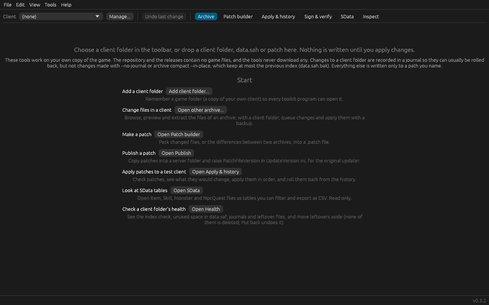
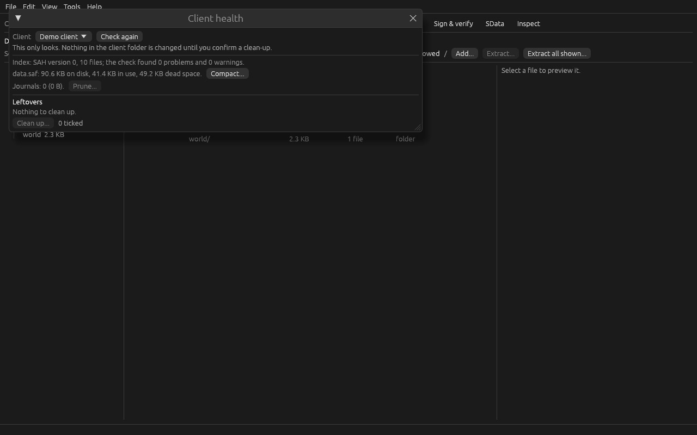
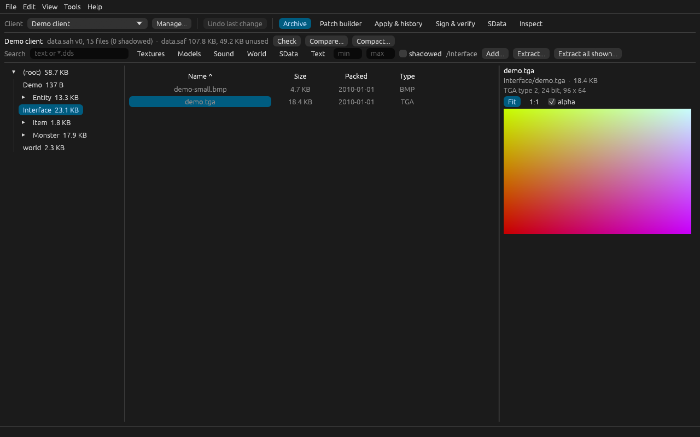
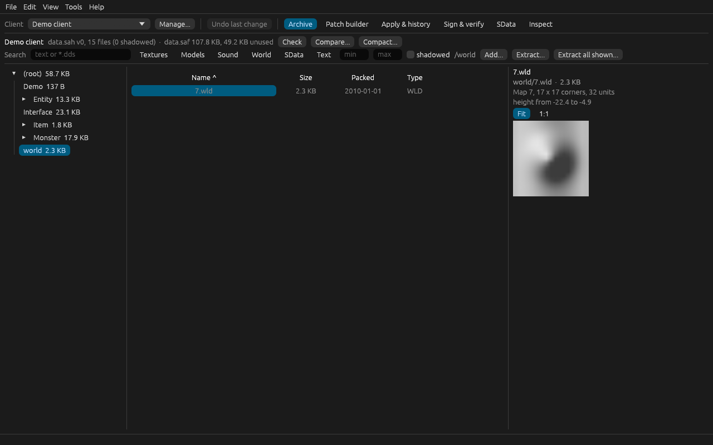
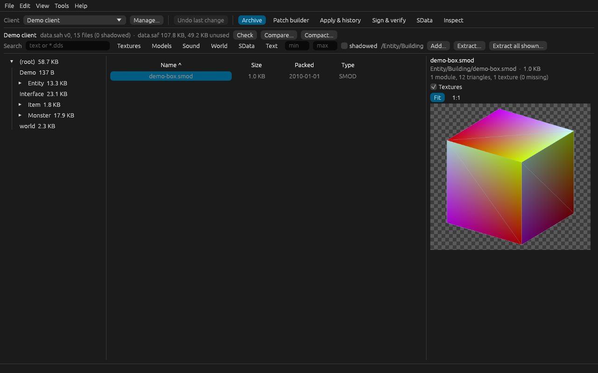
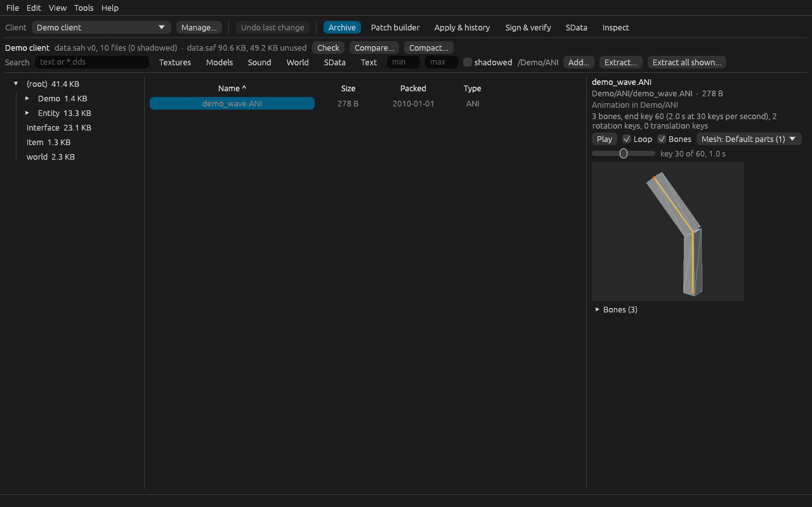
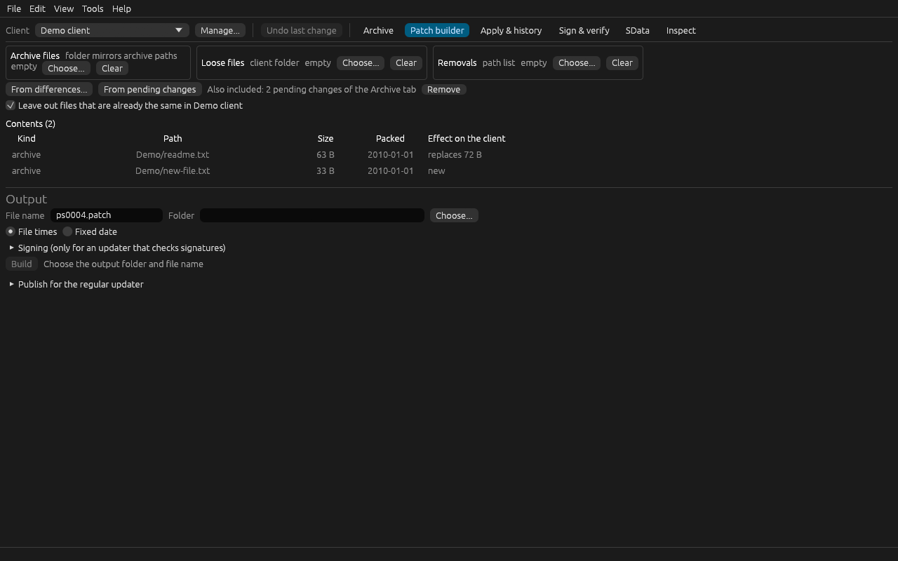
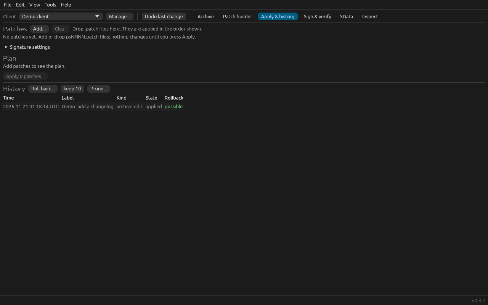
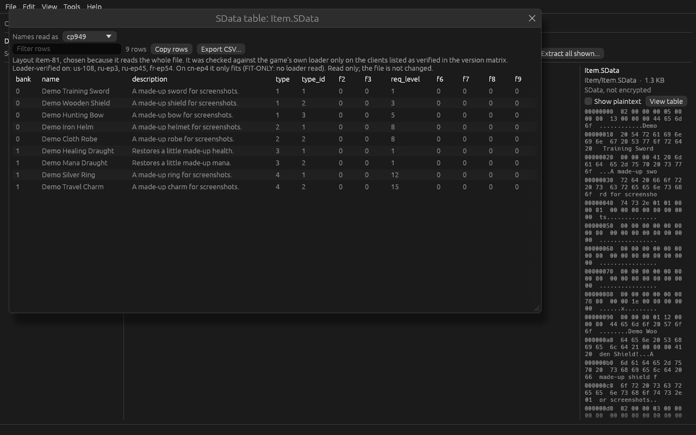
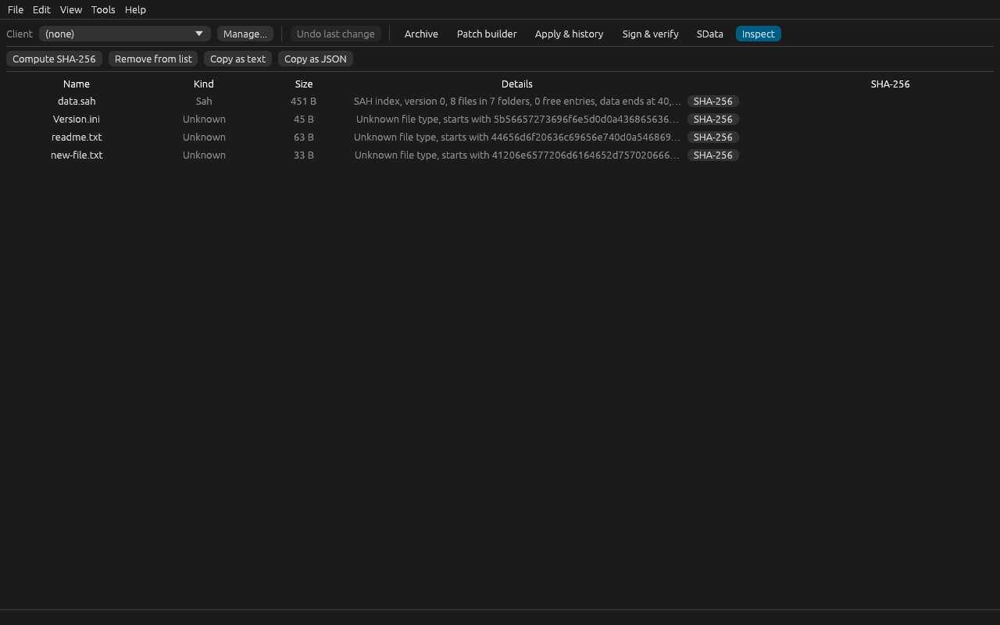

# Shaiya Toolkit

Shaiya Toolkit is the desktop app (`shaiya-toolkit`): browse and edit a client's `data.sah`/`data.saf`, build, sign and apply patches, convert SData files, and inspect files. It does the same work as the [`shaiya` command line](shaiya.md), through the same library code, with the same journals and backups. New here? Follow [the five-minute guide](../getting-started.md).

```
shaiya-toolkit [FILES...] [--data-dir DIR] [--no-settings] [--smoke [REPORT_FILE]]
shaiya-toolkit DEMO_DIR --shot OUT.png [--size WxH] [--scene NAME]
```

`--data-dir` keeps settings and the saved client folders in `DIR`; `--no-settings` writes no settings; `--smoke` opens the real window, renders five frames, writes `ok <adapter> <backend>` (or the error) to the report file and exits with 0 or 1 (2 for a bad flag), a quick check that the graphics stack works. `--shot` is for the screenshots of these docs and is described under [Screenshots](#screenshots). Files named on the command line are handled like files dropped on the window. Only one copy of Shaiya Toolkit should change a client folder at a time, and not while the game is running from it.

## Client folders

The toolbar picker lists your saved client folders (the same list as `shaiya clients list`, so a client added in one program shows up in the other) and remembers the last one used.

- **File > Add client folder...** (also on the picker) asks for a folder holding `data.sah` and a name. You can also drop a folder on the window and choose "Open this client".
- **File > Manage client folders...** shows each client with its status, SAH version, file count and `Version.ini` CheckVersion and CurrentVersion; rename, edit the note, remove from the list (files untouched), or **Use another archive pair...** which swaps a different `data.sah`/`data.saf` in (the current pair is kept as `data.<UTC stamp>.sah/saf`; there is a "swap back"). The button is greyed out while that client's folder has queued changes, whichever client they were made on and also when the client is not the active one (hover: "Apply or discard this client's queued changes first").
- **Open other archive...** opens any `.sah` (for example a stock `data.orig.sah`) read-only; changes to it can only be saved as a new archive.
- **File > Client health...** (also the **Health...** button of a client in the Manage dialog, and the command palette) opens the [Health window](#client-health).
- Shaiya Toolkit never scans your disks for clients. When a client opens, it finishes or discards the leftovers of an interrupted change and says so in the Activity panel.

## The Start page

With no client or archive open, the Archive tab shows a **Start** page: one line for each job and a button that opens the right place. **Add client folder...** asks for a folder and a name; **Open other archive...** opens any `data.sah` read-only; **Open Patch builder** and **Open Apply & history** switch to those tabs; **Open Publish** opens the Patch builder with its publish section open; **Open Health** opens the [Health window](#client-health) for the open client (also when it is no longer in the saved list), or the first saved client that is there. The page goes away as soon as an archive opens.



## Client health

**File > Client health...** opens a window for one client: the open client, or else the first saved client that has a `data.sah` (pick another saved client at the top; **Check again** reads it again). It only looks: nothing in the client folder changes until you confirm a clean-up. It shows the index check (problems and warnings), the size of `data.saf` with its dead space and a **Compact...** link (the Archive tab's Compact confirmation when that client is the open one; otherwise it says to open the client first), the journals with a **Prune...** link (the Apply & history confirmation, again only when that client is the open one), a change that did not finish, `Version.ini` `StartUpdate=UPDATE_START` (explained, never edited), the leftovers with a checkbox each, and the earlier cleanup folders with **Put back...**. Only the leftovers that no undo, swap back or uninstall may need are ticked at first. **Clean up...** moves the ticked files into `shaiya-toolkit-backups/cleanup-<UTC>/` in the client folder and deletes none of them (an interrupted change is finished or discarded first by the same recovery every Toolkit write runs); **Put back...** moves them back and does not run that recovery. What each leftover is, what is never offered, and the command line: [Client health and clean-up](../guides/client-health.md).



## The six tabs

**Archive.** The folder tree on the left, the file table in the middle, a preview on the right.



The map, model and animation previews, on the synthetic demo client:







- Search (Ctrl+F): plain text matches part of a path; text with `*`, `?` or `[` is a [glob pattern](shaiya.md#conventions-every-command-follows-them). Filters for file type and size; a toggle shows shadowed entries.
- Preview: images (DDS, TGA, BMP) with a checkerboard, a `world/<id>.wld` map as a grey top view (north up) with its size and height range (a dungeon map names its `.dg` file and has no picture yet), an `.smod` model as the textured, lit picture of the SVMap Editor's Models window with "N modules, N triangles, N textures (N missing)" (a `.3DC` skinned mesh shows its rest pose with its counts and the texture its list file names for it, with a Texture choice when a list names several, and a grey picture with a note when no list names one, the texture is not in the archive or Textures is off, see [which texture a model uses](../formats/textures.md#which-texture-a-model-uses); an `.ANI` animation plays on meshes found by name in the sibling `3DC` folder, each with its default texture, with Play/Pause, a slider, Loop, Bones and a Mesh choice, see [animations](../formats/ani.md#in-the-archive-tab); a `.VANI` ([format page](../formats/vani.md)) plays its steps at one step per `frame_ms` milliseconds (inferred), a `.3DO` ([format page](../formats/3do.md)) shows its mesh with its `.ITM` texture and plays its frames when it has any (only `Item/3DO/arrow.3DO` on US EP4.5), a `.3DE` ([format page](../formats/3de.md)) shows its mesh with its own texture from `Effect/DDS` and plays its frames as positions (inferred); the pictures are a drawing of the toolkit, not the game's renderer, a `.MANI` ([format page](../formats/mani.md)) is a table of its 20 fields with every meaning labelled inferred; a `.3DC`, `.ANI`, `.VANI`, `.MANI`, `.3DO` or `.3DE` that does not read shows its error and the bytes as hex, also when its bytes look like text), text with a choice of encoding (code page 949 first), SData with its checksum state and a "Show plaintext" switch, anything else as hex (Ctrl+G jumps to an offset). Files with no `data.saf` next to the index open in an index-only mode: no previews, extraction or changes. A Textures check box on the `.3DC`, `.ANI`, `.3DO` and `.3DE` previews turns the textures off (the models are drawn grey; an `.smod` and a `.VANI` have their own textures and show no such box); a texture found by name in another folder than its list file says "(found in another folder)" in its line. The width of the preview pane (drag its left edge) and the Loop, Bones, Fit, alpha and Textures switches are remembered between files and between starts. On an animation or a model picture: the buttons `<` and `>` (keys `,` and `.` while no text box has the keyboard) pause and move one frame, the Speed box plays at 0.25, 0.5, 1, 2 or 4 times the source rate, dragging the picture turns the model (the pictures are made again when you let go, on a background task), the wheel zooms (made again once the wheel stops; the picture on screen is scaled meanwhile), a double click or Reset view returns to the default view, and Save frame as PNG... writes the frame on screen (or the still picture) to a `.png` file outside every client folder (a folder inside a client is refused with "Choose a folder outside the client" and nothing is written). The view, the speed and the sort key and direction of the file list are remembered between files and between starts; a value in the settings file that is out of range (a speed outside 0.25 to 4, a zoom of 0 or less, a number that is not finite, an unknown sort key) is replaced by its default.
- Right-click a file: Extract..., Extract with folders..., Copy path, Copy as JSON, Show in folder tree, Replace with file..., Remove, Decrypt to file... (SData), and for an `.ANI`, `.3DC`, `.VANI`, `.MANI`, `.3DO` or `.3DE` file Export as JSON..., also in the command palette when exactly one such file is selected. Pick a `.json` file outside every client folder (the open client's folder and any saved client's folder are refused); the Toolkit writes the JSON text of that file as a background task, and it imports back to the same bytes (the entry is off while only the index is open, without `data.saf`); turn an edited JSON back into a file with [`shaiya anim import`](shaiya.md#shaiya-anim). The Toolkit has no import.
- **Export folder as JSON...** (right-click a folder row, with `data.saf` open): pick a folder outside every client folder (the open client's folder and every saved client's folder are refused before anything is read). A background task writes every `.ANI`, `.3DC`, `.VANI`, `.MANI`, `.3DO` and `.3DE` file under that archive folder, at any depth, as `<archive path>.json` under the folder you picked (the archive path is kept, `.json` is added to the file name, folders are made). Progress shows in Activity and can be cancelled: the files already written stay, and the status line says `Export cancelled: wrote N of M files to <dir>`. When it ends the status line says `Exported N of M files to <dir> (K failed)` and a window lists each failed file with its reason (a file that does not read, a name the archive writers refuse, an output that already exists: existing files are kept, never replaced). It is the same JSON as Export as JSON... and [`shaiya anim export --out-dir`](shaiya.md#shaiya-anim) writes.
- **Compare with...** (right-click an `.ANI`, with `data.saf` open): a window with a box listing the saved clients ("the same file in <client>": that client's archive is opened read-only and the same path is read there) and the other `.ANI` files of the same folder. **Compare** reads both files on a background task and shows what [`shaiya anim diff`](shaiya.md#shaiya-anim) shows: the skeleton differences, the end keys, and a table of the bones whose pose differs (largest turn first, at most 20 rows; turn in degrees, move in units, key counts of both). Nothing is written. A client that does not hold the path says so.
- A `.3DC` preview with a skinned mesh has an **Animation: play on this mesh** box listing the `.ANI` files of the same rig (the same name prefix as the Mesh box of an animation preview, in the sibling `ANI` folder) whose bone count is above the highest bone the mesh uses, in name order, at most 64. Choosing one opens that animation on this mesh.
- In a `Character/<race>/ANI` folder the search line has a **Rig** box (`all` or one of the four rigs of that race); the list then shows only the animations whose name starts with that rig. Elsewhere the box is not shown and the filter does not apply.
- **Extract** asks for a folder; if files exist you choose Skip existing, Overwrite or Cancel. Progress shows in Activity and can be cancelled (files already written stay).
- **Pending changes.** Dropping files on the tab opens an "Add to archive" dialog (target folder, whether to keep the dropped folder's name, "new" or "replaces" per file, and the [checks before files go in](#checks-before-files-go-in)); "Replace with file..." and Delete queue the other changes. Queued changes appear in a strip at the bottom and in the table (`~` replaced, struck through removed, italic added). **Nothing is written until you apply.** Ctrl+Z / Ctrl+Y undo and redo in the queue. The queue belongs to the client it was built on: switching to another client (or opening a plain archive file) keeps it, the Archive tab shows the active client's queue, the client picker marks a client that has queued changes ("US test - 3 queued"), and the queue is only ever applied to its own client. The queues are kept in memory only.
  - **Apply to client...** asks for confirmation, then appends to `data.saf`, writes a journal and replaces the index. The handle Shaiya Toolkit holds on `data.saf` is released first.
  - **Save as new archive...** writes a new, compacted pair and leaves the client alone.
  - **Make patch...** fills the Patch builder from the queue.
  - **Discard** drops the queue (asks first). Quitting with a queue on any client asks once and lists each client with its count; "Save all" never writes a client by itself. Removing a client from the list, or renaming it, while it has queued changes asks first and drops them, unless another saved client points at the same folder: then nothing is asked, the queue stays with the folder (the first remaining client on it, in the list's order, now owns it; a renamed client keeps it under its new name) and only the list entry changes.
- **Check** (and **Deep check**) reports problems, warnings and info grouped by code, with clickable paths; Copy report and Save report. **Compare...** opens a window with two pickers: **OLD (left)** and **NEW (right)**, each a saved client or an archive file (**Archive file...**); the left side starts as the open client. **Compare** diffs OLD against NEW (added = only in NEW, removed = only in OLD, different, same, unknown; **Swap sides** exchanges them). When nothing differs it says so and **Make patch from differences** stays disabled. **Make patch from differences** builds the patch that turns OLD into NEW (the added and different files of NEW, and the files only OLD has as removals) in the Patch builder, whose source line reads "differences, OLD ... -> NEW ...".  **Compact...** rewrites `data.saf` without unused space; the confirmation says how many earlier changes can then no longer be rolled back.



**Patch builder.** Three sources, or the differences of two archives, or the pending changes: a folder of archive files (paths inside it become archive paths), a folder of loose files (copied into the client folder, for example `game.exe`), and a removal list. With a client selected, the box "Leave out files that are already the same in NAME" (on by default) compares every archive file with the client's copy (same size and SHA-256, read-only) and leaves the identical ones out of the patch; the table shows them as "same, left out" and Build waits for the comparison. When that box leaves out every file (for example when the selected client is itself the NEW side of the differences), the builder says "Nothing differs: all N files are already the same in NAME, so the patch would be empty. Untick ..." in the warnings and as the reason Build is disabled. The contents table shows what each entry does to the selected client (new, replaces, not present, overwrites) and a problems column; Build is disabled while a name is invalid. Output name (suggested as the next `psNNNN.patch` from the client's `Version.ini`), timestamp, optional signing (a closed section "Signing (only for an updater that checks signatures)": a secret key file and CheckVersion; a patch is built unsigned unless you use it, and the result line says "unsigned" or "signed"). Warnings match the CLI (the original updater only fetches `psNNNN.patch`; `remove.txt` needs the toolkit or a replacement updater). The same checks list their findings under the table and mark the files they are about. After a build: Show folder, Apply to a client..., Verify.

**Publish for the regular updater.** A section of the Patch builder (the Start page's **Publish a patch** opens it). Add one or more `psNNNN.patch` files (or **Use the patch just built**), choose a server folder, the layout (`Shaiya/UpdateVersion.ini` with `Shaiya/patch/`, or both in the folder), the CheckVersion (needed for a new `UpdateVersion.ini`) and optionally the UpdaterVersion, then **Check the plan**. The plan lists each patch (new, or already published as the same file), what the ini becomes (`PatchFileVersion 109 -> 110`), warnings (removals are ignored by the original updater) and the file checks; a refusal is shown in red and **Publish** stays disabled. A broken file (encrypted twice, or a failing checksum) asks once, **Publish anyway** or Cancel. **Publish** then shows the four confirmation rows; there is no undo, and the Undo row says which ini values to set back by hand. It writes only into the server folder (never into a client folder, which is refused), copies and reads back each patch, and writes the ini last. See [Version.ini and UpdateVersion.ini](../formats/version-ini.md).



**Apply & history.** Add patches (drop or Add...; drag to reorder), see for each its structure check and signature state, set a public key and CheckVersion (stored per client; "Require a valid signature" turns on with a key), read the plan (added, replaced, removed, missing, loose files, bytes to append), and **Apply N patches...**. The lower half is the history of journals for this client with the rollback state and the reason when blocked (it is read again when you switch to the tab and when the window gets focus back, so a change made by the command line shows up); **Roll back...** undoes the newest possible one; **Prune...** keeps only the newest N.

**Apply to several test clients...** (the button next to Apply, and the command palette) opens a window to pick patches (it starts with the Apply & history list) and saved clients. **Start** takes the clients one after the other. Each client first shows its own confirmation ("Apply PATCHES to NAME (FOLDER)? Client N of M." with Changes, Writes, Undo, Game, for that client; if the folder cannot be read to work those out, the run stops there and says so, and no Apply is offered), then the patches are applied to it the same way as **Apply N patches...** does it (recover first, the check that the game is not using the files, one journal per patch in that client). Saved clients that point at the same folder get the patches once (the report says which). **Start** waits while the Archive tab or the Apply tab is applying. The run stops at the first client that cannot be planned or fails, or when you answer **Stop here**, and says which clients were changed (with their journals) and which were not touched; a client that failed while applying may still have had an unfinished earlier change recovered first, which writes to it, so check its history. After an internal error the report says that client "may be partly changed" (with the journals that appeared) instead of listing it as not touched. A client that already got its patches stays changed; roll it back from Apply & history with that client open. A client whose files are in use is not retried.

While an apply to several clients runs, the other actions that write to a client are greyed out (hover: "Applying patches to several clients; wait until it ends"): Apply to client..., Save as new archive..., Discard and Compact... in the Archive tab (buttons, command palette and keys); Apply, Roll back, Undo last change and Prune in Apply & history; Clean up, Put back, Compact and Prune in Client health; Use another archive pair...; and switching the client (the picker, Open, Open recent). Adding and replacing files (queueing) stays available.

**Undo last change.** When the open client has a change that can be rolled back, the toolbar button **Undo last change** and Edit > **Undo last applied change (roll back)...** (also in the command palette) open the Roll back confirmation of the newest one, the same as **Roll back...** in Apply & history. When the newest change cannot be rolled back (after Compact, or after another tool changed `data.sah`), both are greyed out and the hover text gives the reason. Ctrl+Z still undoes only the queue of pending changes.

**Sign & verify.** Optional: the original updater does not check signatures. Generate a key pair (secret first; existing files are refused, never overwritten), sign patches or an updater executable (`.sig` next to each file; an existing one asks "Replace signature"), and verify signatures against a public key, optionally against a client (is the patch applied?). Shaiya Toolkit never stores key contents; the secret key's *path* is remembered only if you tick "Remember where my secret key is".



**SData.** Drop SData files or folders, or add all SData of the open client. The table shows encrypted or plain, checksum state and plaintext size. **View table** (or a double-click on a name) opens the selected file as a table: rows and columns (only the rows on screen are drawn), a filter box (every word must occur in the row, any letter case), the row count ("3 of 3,000 rows" while filtering), **Copy rows** (tab separated, with the column names), **Export CSV...** (the shown rows), a choice of code page for the names, and for `NpcQuest.SData` a choice between its tables. A file no layout fits is shown as hex under the sentence "No table layout fits this file (N bytes); shown as hex". The view is read only. For a layout read from a client's own loader it says the layout was chosen because it reads the whole file and was checked against the game's own loader only on the clients listed as verified in the [version matrix](../version-matrix.md), followed by "Loader-verified on: <clients>."; for a FIT-ONLY layout (one that reads the whole file but was not read from any client's loader) it says "FIT-ONLY: this layout reads the whole file, but it was not read from any client's own loader. Columns are named by position; values may be split wrongly." See [FIT-ONLY layouts](../formats/item-sdata.md#fit-only-layouts). The Archive tab's preview of an SData file has the same **View table** button. Decrypt to folder..., Encrypt to folder... (with "Match the originals' headers", which is what makes an unchanged file come out byte-identical) and Check. Outputs always go to a folder you choose; in-place conversion is a CLI feature.



**Inspect.** The file inspector: open or drop files, see what each is (SAH index, SAF data, SData encrypted or plain, patch, signature, `game.exe` build) with Name, Kind, Size and Details, the same text `shaiya info` prints. SHA-256 per row or for the selection runs in the background with progress in Activity and can be cancelled. Copy as text / Copy as JSON put the selected rows on the clipboard, handy for bug reports (never attach game files to a report; hashes are enough).

## Checks before files go in

The "Add to archive" dialog, "Replace with file..." and the Patch builder check each SData, `.dds`, `.tga` and `.ani` file and each empty file before it is queued or built, and list what they find. The checks run in the background; the dialog's **Queue changes** waits for them. They are the same as the command line's ([Checks before files go in](shaiya.md#checks-before-files-go-in)): `sdata-double-encrypted`, `sdata-crc-bad`, `sdata-state-differs`, `texture-unreadable`, `empty-file`, `anim-unreadable`, `anim-invalid`, `anim-rig-differs`, `anim-first-field-differs`.

- Findings only warn. There are two exceptions, and the dialog asks once for either: a file that is SEED-encrypted twice or whose checksum fails, and an `.ani` whose skeleton differs from the client's copy (`anim-rig-differs`, below): **Add anyway** or **Cancel** (for the SData finding the Patch builder says **Build anyway**; the skeleton question never appears there, because a patch build has no rig check). Nothing is queued until you answer, and Cancel leaves the Add dialog open. If a check cannot finish (it fails or is stopped), the files count as unchecked and it asks the same way, with a `check-incomplete` line.
- An `.ani` file is compared with the animation already in the client's archive at the same path (the Add dialog and "Replace with file..."; not the Patch builder). When its skeleton (bone count, parents, reference matrices) differs, the dialog asks once, **Add anyway** or **Cancel**, like the two SData findings above, because meshes are matched to bones by index. Only the "Replace with file..." question is titled "The skeleton differs from the file it replaces" (otherwise, when an SData finding or an unfinished check also asks, it keeps "This file looks broken"); the Add dialog keeps its title "Some files look broken". A different first field (inferred: the start key; not checked in the game), an `.ani` that does not read (`anim-unreadable`) and one with validation errors (`anim-invalid`) only warn.
- A plain SData file against an encrypted copy in the client (or the reverse) is shown as `sdata-state-differs` and queued without a question; the Patch builder cannot compare because a patch has no client copy.
- A texture the toolkit cannot read may still work in the game; the finding only says the toolkit's own reader refused it.

## Confirmations and prompts

Buttons say what they do and the risky one is marked. Every confirmation that changes a client folder shows the same four rows under its text:

| Row | What it says |
|---|---|
| **Changes** | The counts, taken from the plan that is applied (added, replaced, removed, loose files; for Compact the size before and after; for Roll back what is restored). |
| **Writes** | Each file or folder that changes, with sizes: `data.sah`, `data.saf` (how much is appended), the journal folder, loose files. |
| **Undo** | How to get back: "Apply & history > Roll back", or "no undo" (Compact makes no journal; Prune deletes journals; a rollback has none of its own). |
| **Game** | "must be closed (checked)" on Windows; elsewhere "cannot be checked on this system". |

| When | Text and buttons |
|---|---|
| Apply pending changes | "Apply N changes to NAME (folder)?" and the four rows. **Apply N changes** / Cancel. |
| Apply to several clients | "Apply PATCHES to NAME (FOLDER)? Client N of M. Signatures: ..." and the four rows for that client; **Apply to NAME** / **Stop here**. One such question per client, each shown after the previous client was applied. |
| Queued changes of a client you remove or rename (only when no other saved client is on its folder) | "NAME has N queued changes that were not applied. Removing (Renaming) it drops them ... Drop them and continue?" **Drop them and remove** / **Drop them and rename** / Cancel. |
| Apply patches | "Apply PATCHES to NAME? Signatures: ..." where the signature state is "not used (unsigned patches)" when the client has no public key, "valid" when every patch verifies, "NOT CHECKED" when a key is set but the patches are not verified; then the four rows (one journal per patch). **Apply N patches** / Cancel. An invalid signature with "Require" on disables the button and says why. |
| Compact | "Compact data.saf of NAME?" and the four rows; Undo says "no undo: compacting makes no journal" and how many earlier changes can then no longer be rolled back. **Compact** / Cancel. |
| Roll back | "Roll back LABEL (applied TIME)?" and the four rows (index restored, `data.saf` cut back, loose files restored and deleted, the journal id). **Roll back** / Cancel. Also reached by **Undo last change**. |
| Publish | "Players' updaters read UpdateVersion.ini ... a wrong value there stops every player's update" and the four rows: Changes (files copied, `PatchFileVersion A -> B`; a CheckVersion change says every player is told to reinstall), Writes (the files in the server folder), Undo ("no undo of its own, and no backup", with the old ini values), Game ("not involved: this writes into a server folder"). **Publish** / Cancel. |
| Prune | Which journals are deleted and that those changes can then no longer be rolled back. **Prune** / Cancel. |
| Swap archives | "Put PAIR in place of NAME's data.sah/data.saf?" and the four rows (the current pair is renamed to `data.<UTC stamp>.sah/.saf`). **Swap archives** / Cancel. |
| Clean up | "Move N files of NAME into a cleanup folder? None of them is deleted." and the four rows: Changes (the files and their size), Writes (the new `shaiya-toolkit-backups\cleanup-<UTC>\` with `manifest.json`; every file is renamed into it, none is copied or deleted; the recovery that runs first may remove an interrupted change's `data.*.compact` files or cut `data.saf` back), Undo ("Put back in Health, cleanup-<UTC>"), Game (as above). **Clean up** / Cancel. |
| Put back | "Move the files of cleanup-<UTC> back into NAME?" and the four rows (Game says "not involved": no `data.sah` or `data.saf` is opened). **Put back** / Cancel. |
| Existing outputs | Skip existing / Overwrite / Cancel (extract, SData); Overwrite / Cancel (patch); Replace signature / Cancel. |
| Discard, reload with pending changes | Discard / Keep; reload asks first. |
| **The game or another program has the files** | "NAME's data.saf is open in another program (is the game running?). Close it and press Retry." **Retry** / Cancel. Nothing has been changed; close the program and press Retry. (Windows only; elsewhere the toolkit cannot tell.) |

## Keyboard

| Keys | Action |
|---|---|
| Ctrl+1 ... Ctrl+6 | Switch tab: Archive, Patch builder, Apply & history, Sign & verify, SData, Inspect |
| Ctrl+F | Focus the search box (Esc clears it) |
| Up, Down, PageUp, PageDown, Home, End, Shift or Ctrl+click, Ctrl+A | Move and select in the table |
| Enter | Open the selected folder; on a file, focus the preview |
| Backspace, Alt+Up | Parent folder |
| Delete | Queue removal of the selected files |
| Insert | Add files to the folder shown |
| Ctrl+E, Ctrl+Shift+E | Extract the selection, extract everything shown |
| Ctrl+Enter | Apply pending changes (Archive tab) |
| Ctrl+G | Go to an offset (hex preview) |
| Ctrl+C | Copy selected paths |
| Ctrl+Z, Ctrl+Y | Undo, redo in the pending queue |
| F5 | Reload the archive (asks first when changes are pending) |
| F1 | Help |
| Ctrl+Shift+P | Command palette: every action with its shortcut (Esc or a click outside closes it) |
| Ctrl+O, Ctrl+Shift+O | Open files, open by path |
| Ctrl+J | Activity panel (progress, cancel) |
| Ctrl+, | Preferences |

(On macOS read Ctrl as Cmd.)

## The shell

Menus: File, Edit, View, Tools, Help. **Tools** lists the command palette and the other toolkit programs that ship (Shaiya SVMap Editor); a program that is not in the folder next to the running one is shown as not installed. **Edit > Preferences** (Ctrl+,): theme (dark, light, system), UI scale, autosave and backup counts, the font used for Korean and Chinese names, whether extracted files keep the archive's pack time, and the Inspect column widths. **Help > About** shows the version, the git revision and the third-party notices; **Help > Open log file** and **Open data folder** open the toolkit's own files with your system's file opener.

**Help > Support the project** opens the author's donation page in your default browser. It happens only when you click it; Shaiya Toolkit makes no network connection of its own, and nothing is sent.

Korean and Chinese names need a font: Shaiya Toolkit looks for a system font at start (Malgun Gothic or Microsoft YaHei on Windows, Apple SD Gothic Neo or PingFang on macOS, Noto Sans CJK or a similar font on Linux). Name a font file in Preferences, or set `SHAIYA_TOOLKIT_FONT`, to use another one.

Settings and logs: see [install.md](../install.md#portable-mode-and-where-settings-live). Journals and backups are kept in each client folder, see [undo and recovery](../guides/undo-and-recovery.md).

## Screenshots

`shaiya-toolkit DEMO_DIR --shot OUT.png [--size WxH] [--scene NAME]` opens the real window on a synthetic demo client, waits until the background work is idle, saves a PNG of the window to `OUT.png` and exits with 0, or with 1 and a reason on standard error (2 for a bad flag). `--size` is the window size in points (default 1280x800; the PNG has the display's pixels). `--shot` reads and writes no settings unless `--data-dir` is given, and a saved client folder is then shown by its name, never by its path (also in the Manage client folders window). The status bar shows no version and the demo change of `apply-history` is dated 2010-01-01, so a picture does not go stale or show when it was taken; with `--data-dir`, `--shot` refuses a saved `Demo client` that is not the folder given and does not reopen the last client. `DEMO_DIR` is made by `cargo xtask demo-client DIR`: a folder of made-up files only, marked by `shaiya-demo-client.txt`; a scene refuses any folder without that marker, because `apply-history` makes one real change in the folder it is given. Scenes: `start`, `archive`, `patch-builder`, `apply-history`, `sdata-table`, `health`, `map-preview`, `model-preview`, `anim-preview`, `inspect`. How the pictures of these docs are retaken: [Editing these docs](../dev/docs-site.md#screenshots).

## Left out on purpose

Dragging files out to the desktop, audio playback, text editing, editing SData tables (that is the planned SData Editor), several archives open at once (use Compare, which takes any two saved clients or archive files), in-place SData conversion, autosave of the pending queue (nothing is written before Apply, so a crash loses only the queue), and anything that uses the network.
